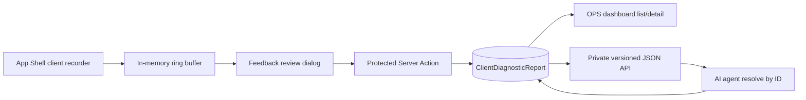

> 由 scope skill 于 2026-09-02 生成
> 状态：已批准 2026-09-02

# 客户端诊断报告与 AI 问题队列

## 目标

为偶发的页签切换卡顿建立用户主动反馈能力，保留点击前后的有限客户端现场并安全传回服务端；现有 OPS 后台和受限的 AI agent 接口都能读取稳定的结构化问题，agent 修复并验证后将问题标记为已解决。

## 决策基线

### 需求边界

- 入口固定在已登录业务页的现有导航区域：桌面侧栏和移动底部栏的版本号附近都提供低干扰的“反馈卡顿”入口；不新增设置页、独立用户反馈中心或第三方遥测入口。
- 用户点击入口后打开确认面板，面板说明将上传的字段，并警告不要在说明中填写金额、交易备注或其他账本内容；用户可填写一段可选的简短说明，明确确认后才上传。取消、关闭面板或未确认都不得发送报告。
- 客户端只在内存中保留最近 60 秒、最多 100 条诊断事件。诊断数据未提交前不发起诊断上传请求、不写入 `localStorage`、`sessionStorage` 或其他持久化存储；应用已有的页面预取和正常业务请求不属于诊断上传。打开反馈面板时冻结一份现场快照，提交失败时继续保留该快照供显式重试。
- 现场覆盖共享 App Shell 中的导航意图、目标路径、完成、可观测的路由错误、被后续导航取代和 2 秒未完成的 `stalled` 标记，并覆盖脱敏后的 JS `error`、`unhandledrejection`、在线状态、页面可见性和标准化浏览器环境信息。每次用户反馈独立形成一条报告，不做服务端相似问题自动合并。
- 允许上传的路径只能是应用白名单中的 pathname；除用户在反馈面板中主动填写并确认提交的 `userNote` 外，不得自动收集或上传 URL 查询参数、请求体、金额、交易备注、账单内容、截图、DOM、其他原始用户输入、IP、硬件标识或浏览器指纹。错误不上传任意自由文本，只保留固定 `messageCode` 及结构化栈帧中的函数名、文件名、行列号；URL 参数、请求体和用户输入不会进入错误字段。
- 单份报告的序列化技术 JSON 与用户说明合计不得超过 64 KiB；用户说明限制为最多 200 个字符。每个家庭成员按 `Asia/Shanghai` 自然日最多提交 5 份报告。
- 发送成功后向用户显示提交成功和报告编号；发送失败时显示可理解的双语错误和“重试”操作，失败数据只保留在当前页面内存中。刷新或关闭页面后不恢复未发送报告，也不自动重试。
- 诊断报告只服务于导航卡顿和相关客户端异常定位，不修复本次发现的导航根因，不自动上传，不接入会话录制或第三方遥测。浏览器主线程完全冻结导致入口无法响应的情况明确不在本次覆盖范围内。
- 服务端保存报告 30 天。报告状态为 `OPEN` 或 `RESOLVED`；agent 修复并验证后按报告 ID 标记 `RESOLVED`，已解决报告继续保留至 30 天后清理，不提供 agent 硬删除接口。
- 现有 OPS 后台增加诊断报告列表和详情，只有 OPS 管理员可查看。AI agent 使用独立的最小权限 token，通过机器可读接口拉取全部 `OPEN` 报告摘要、按 ID 获取详情，并按 ID 标记已解决；该 token 不得获得 OPS 登录、密码重置、会话撤销或账本数据访问能力。
- agent 列表不分页，返回当前全部未解决报告摘要；报告数量由 30 天保留期和每成员每日 5 份提交上限约束。列表按 `createdAt` 升序、`id` 升序稳定排序，详情单独按报告 ID 获取。
- 用户提交和 agent 操作都必须使用固定版本的 JSON schema 和枚举值。用户提交通过受保护的 Server Action；agent 使用固定端点、方法、状态码和错误 envelope 的私有机器接口。用户报告的家庭、成员和用户身份只能由服务端当前 app session 派生，不能信任客户端字段或 agent 请求中的家庭筛选参数。
- 诊断相关 UI 文案、提交结果、错误提示和 OPS 展示文案必须同步加入 `src/lib/i18n.ts` 的中文和英文消息。真实 agent token 只能存放于未跟踪环境变量或私有部署配置，不得进入 Git 跟踪文件、页面或日志。

### 技术决策

- 在共享 App Shell 建立单一客户端采集器，由现有 `AppFiltersProvider` 覆盖桌面和移动导航；导航事件和全局浏览器事件都写入同一个内存环形缓冲，避免两套导航实现产生不一致的现场格式。采集器只负责观察，不改变现有 `router.push`、`router.replace`、pending 状态或页面数据流。
- 采集器使用白名单 pathname 和固定事件 schema，事件保存相对报告快照的 `elapsedMs`、事件类型及必要的路径/耗时字段；不保存完整 URL。每次导航意图生成唯一 `navigationId`，同一导航的 `navigation_intent`、`navigation_settled`、`navigation_stalled` 和 `navigation_failed` 必须携带该 ID。采集器采用“最新意图优先”：新意图到达时，前一未结束导航写入一次 `navigation_failed`（`failureKind: "superseded"`）并清理其定时器；只有当前活动导航的目标 pathname 变化才可写入 `navigation_settled`。`navigation_failed` 的 `failureKind: "route_error"` 只由业务路由 error boundary 触发；没有可观测失败信号的网络/服务端等待只记录 `navigation_stalled`，不猜测失败原因。
- 错误脱敏不序列化任意 `Error` 或 rejection 对象。`DiagnosticErrorV1` 只允许固定的 `name` token、`messageCode`（`UNKNOWN`、`NETWORK`、`ROUTE_ERROR`、`CHUNK_LOAD`、`TIMEOUT`、`NON_ERROR_REJECTION`）和有界的 `stackFrames`；每个栈帧只保留函数名、文件名、行列号，文件名去除 origin、query、fragment 后再限长。服务端再次使用严格 schema 校验和总字节数限制，不能因为客户端声称已脱敏而放宽边界。
- 用户报告提交 action 接收单个 `{ report: DiagnosticReportV1 }` 对象，`clientReportId` 和 `userNote` 只在该对象内出现，先调用 `requireAppSession()`，再执行 schema、pathname、事件数量、文本长度、64 KiB 和按成员自然日的频率校验。服务端写入的 `householdId`、`memberId` 和关联用户信息全部来自 session；客户端不得指定归属家庭或成员。
- 诊断报告使用独立的 `ClientDiagnosticReport` 数据模型，不扩展现有 `AppEvent` 枚举或复用严格的业务事件 metadata。模型保存稳定的 `clientReportId`、服务端家庭/成员归属、schema/version 摘要、状态、结构化 payload、创建时间和解决时间；为列表与生命周期查询建立状态/时间及家庭/状态/时间索引。
- `clientReportId` 使用客户端生成且在服务端唯一。相同报告在传输结果不明确后的重试必须返回原报告结果；若 ID 已属于其他家庭或成员，服务端不得返回其内容，并以通用冲突结果结束，避免利用幂等键探测其他数据。
- 过期清理在用户提交、OPS 查询和 agent 列表/详情/resolve 操作前执行批量删除；所有读取同时过滤 `createdAt` 早于 30 天截止时间的报告。仓库没有现成诊断定时任务，因此不要求新增调度器，访问间隔期间的物理清理延迟作为残余风险保留。
- 用户提交 action 与 agent 接口分离。用户 action 沿用现有 Server Action 和 app session 保护；agent 接口使用 `Authorization: Bearer` 携带私有环境变量 `DIAGNOSTIC_AGENT_TOKEN` 中的独立 token，只开放报告列表、报告详情和按 ID resolve 三类能力，并返回稳定 JSON，不提供数据库直读、批量删除或其他 OPS 动作。token 缺失或为空时接口 fail closed；比较使用 timing-safe 方式；响应设置 `Cache-Control: no-store`，token、请求头和报告正文不得写入日志；轮换只通过替换私有 env 并重启服务完成。
- agent API 的列表返回固定摘要字段：`reportId`、`status`、`createdAt`、`appVersion`、`currentPathname`、`targetPathname`、`stalled`、`eventCount` 和最多 80 个字符的 `userNotePreview`；详情返回同一版本的完整事件、结构化错误和环境。API 不返回未在契约中定义的字段，也不把 Prisma 模型原样暴露；不返回邮箱、密码、session token 或交易数据。状态变更返回 `reportId`、`RESOLVED` 状态和服务端时间。
- OPS 后台通过现有 OPS 管理员会话读取报告并以人类可读方式展示结构化字段，同时保留可复制的报告 ID和事件时间线；OPS 页面不提供账本编辑能力。agent resolve 只写入状态、解决时间和固定的 agent 标识，不记录 token 值。

## 设计视图

### 功能设计

用户在任一业务页点击导航附近的“反馈卡顿”后，面板先显示本次将上传的技术字段范围和不要填写账本内容的提示，并预填当前内存现场快照。用户可以取消、填写不超过 200 个字符的说明或确认提交。确认后按钮进入提交中状态并防止同一快照重复点击；Server Action 成功则显示报告编号并清除待发送快照，失败则保留快照并显示重试操作。取消或未确认只保证不发送诊断提交请求，不影响应用已有的预取和业务请求。

现场事件从 App Shell 加载开始写入内存环形缓冲。用户点击桌面或移动页签时先写入当前 pathname、目标 pathname、`navigationId` 和导航开始时间；目标 pathname 提交后写入同 ID 的完成事件并计算耗时；2 秒仍未完成时写入一次同 ID 的 `stalled` 事件；新导航取代旧导航或业务路由 error boundary 报错时写入带 `failureKind` 的 `navigation_failed`。全局 JS 异常、未处理 Promise、网络在线状态和页面可见性变化按固定事件格式追加。用户打开反馈面板时复制最近 60 秒内的事件，之后的交互不会覆盖这份待发送快照。

服务端接受报告后，OPS 管理员可在现有后台查看未解决和近期已解决报告；报告详情以版本化事件时间线显示，不出现交易内容。AI agent 定期读取全部 `OPEN` 报告摘要，再按报告 ID获取需要分析的详情；修复并验证后调用 resolve，使报告从待处理队列消失，但在 30 天期限内仍可由 OPS 查看。相似报告不由服务端合并，agent 可自行判断是否属于同一根因。

### 技术设计

#### 整体方案



客户端采集器是导航现场的唯一写入点，拥有环形缓冲和待发送快照；反馈面板只读取快照、收集用户说明并触发提交。它不拥有家庭身份，也不把客户端路径或成员字段作为授权依据。Server Action 是用户侧唯一写入口，负责从当前 session 派生家庭与成员、校验 payload、执行幂等/限流/保留期清理并创建报告。

`ClientDiagnosticReport` 是诊断数据的权威存储，业务 `AppEvent` 继续承载已有的粗粒度页面/业务事件，两者不混用。OPS 页面通过 OPS 管理员会话访问全部允许展示的诊断报告；agent API 通过独立 token 只访问 `OPEN` 报告并执行 resolve。agent API 不接收 `householdId`、`memberId` 或交易查询条件作为筛选权限，报告范围由服务端固定决定。

用户侧和 agent 侧的数据流如下：

```text
导航/浏览器事件
    -> 60 秒/100 条内存缓冲
    -> 用户打开反馈并冻结快照
    -> 确认后 Server Action + 当前 app session
    -> schema/脱敏/大小/限流/幂等校验
    -> ClientDiagnosticReport(OPEN)
    -> OPS 查看 / agent GET OPEN 摘要与详情
    -> agent 修复验证后 resolve(reportId)
    -> RESOLVED 保留至 30 天后按访问点批量清理
```

#### 关键结构

- `DiagnosticReportV1` 使用固定 `schemaVersion: "diagnostic-report.v1"`，包含 `clientReportId`、客户端采集时间、应用版本、locale、当前/目标 pathname、`events`、`errors`、标准化 `environment` 和必填但可为 `null` 的 `userNote`。`clientReportId` 使用 `crypto.randomUUID()` 生成的 UUID 字符串；路径只能取 `/home`、`/add`、`/records`、`/records/import`，不带 query 或 fragment。`clientCollectedAt` 使用 UTC RFC 3339 字符串；`events` 最多 100 条，`errors` 最多 20 条，`userNote` 最多 200 个字符。Server Action 的唯一输入为 `{ report: DiagnosticReportV1 }`，不得再接受同字段的顶层副本。
- `DiagnosticEventV1` 是严格 discriminated union：`navigation_intent` 必含 `elapsedMs`、`navigationId`、`currentPathname`、`targetPathname`；`navigation_settled` 必含 `elapsedMs`、`navigationId`、`targetPathname`、`durationMs`；`navigation_stalled` 必含同样字段且 `durationMs >= 2000`；`navigation_failed` 必含同样字段和 `failureKind: "route_error" | "superseded"`；`js_error`/`unhandled_rejection` 必含 `elapsedMs` 和指向 `errors` 的 `errorIndex`；`online`、`offline`、`visibility_visible`、`visibility_hidden` 只含 `type` 和 `elapsedMs`。`elapsedMs` 为 `-60000..0` 的整数，`durationMs` 为 `0..600000` 的整数，`errorIndex` 为 `0..19` 的整数；所有路径来自白名单，不含原始 URL、请求体或业务字段。
- `DiagnosticErrorV1` 不包含任意自由文本 `message` 或原始 `stack`；它只保留固定 `name`（`Error`、`TypeError`、`RangeError`、`ReferenceError`、`SyntaxError`、`DOMException`、`AbortError`、`UnknownError` 之一）、`messageCode`（`UNKNOWN`、`NETWORK`、`ROUTE_ERROR`、`CHUNK_LOAD`、`TIMEOUT`、`NON_ERROR_REJECTION` 之一）和最多 20 个 `stackFrames`。每帧固定包含 `functionName: [A-Za-z0-9_$<>.-]{1,128} | null`、`fileName: [A-Za-z0-9._-]{1,128} | null`、`line: 0..1000000 的整数 | null`、`column: 0..1000000 的整数 | null`；非法字符或无法解析的值转为 `null`，文件名只保留去除 origin、query、fragment 后的文件名。未知错误文本和非 Error rejection 统一映射为固定代码。服务端只接受 schema 中列出的字段，未知字段、非法路径、超长文本和超过 64 KiB 的序列化结果全部拒绝。
- `environment` 固定为 `browserFamily: "chromium" | "firefox" | "safari" | "edge" | "other"`、`browserMajor: 0..999 的整数 | null`、`viewport: { width: 0..10000 的整数, height: 0..10000 的整数 }`、`locale: "zh-CN" | "en-US"`、`online: boolean`、`visibility: "visible" | "hidden"` 和 `effectiveType: "slow-2g" | "2g" | "3g" | "4g" | "unknown"`；不保存完整 user agent、IP、设备/硬件 ID、指纹信息或账户邮箱。
- `ClientDiagnosticReport` 至少包含 `id`、唯一 `clientReportId`、`householdId`、`memberId`、`schemaVersion`、`status`、结构化 payload、`createdAt`、`resolvedAt` 和不含 token 的 `resolvedBy`；状态默认 `OPEN`，resolve 后为 `RESOLVED`。列表查询按状态和 `createdAt` 排序，所有有效查询按 30 天截止时间过滤。
- agent API 使用固定 `schemaVersion: "diagnostic-agent.v1"`。`GET /api/internal/diagnostic-reports` 返回 `{ schemaVersion, reports: DiagnosticReportSummaryV1[] }`，其中每个摘要严格包含 `reportId`、`status: "OPEN"`、`createdAt`、`appVersion`、`currentPathname`、`targetPathname`、`stalled`、`eventCount` 和 `userNotePreview: string | null`（最多 80 个字符），一次返回全部 `OPEN` 摘要且不分页；`GET /api/internal/diagnostic-reports/{reportId}` 返回 `{ schemaVersion, report: { reportId, status, createdAt, resolvedAt, diagnostic: DiagnosticReportV1 } }`，只允许读取当前 `OPEN` 报告；`POST /api/internal/diagnostic-reports/{reportId}/resolve` 接收 `{ schemaVersion: "diagnostic-agent.v1" }`，返回 `{ schemaVersion, reportId, status: "RESOLVED", resolvedAt }`，重复调用返回同一状态结果。所有时间使用 UTC RFC 3339 字符串，缺失时间显式为 `null`；无效 token 返回 `401`，非法请求或 schema 返回 `400`，不存在、过期或已解决的详情返回不含内容的 `404`；错误响应固定为 `{ schemaVersion, error: { code: "UNAUTHORIZED" | "INVALID_REQUEST" | "NOT_FOUND" | "CONFLICT" | "INTERNAL" } }`。API 不接受家庭筛选参数、批量 ID 或删除指令。

#### 实现流程

App Shell 初始化采集器后，采集器维护带时间戳的环形缓冲；每次写入先限制事件字段和长度，再丢弃超过 60 秒或超过 100 条的最旧事件。导航入口继续执行现有点击条件判断，调用共享的导航函数前生成 `navigationId` 并记录 intent；新 intent 取代旧活动导航时记录 `failureKind: "superseded"` 并清理旧定时器；pathname 变化且仍匹配活动导航目标时由共享 provider 标记 settled；导航启动后设置一次 2 秒定时器，未完成时写入 stalled。新增的业务路由 error boundary 在能关联活动导航时写入 `failureKind: "route_error"`，否则只保留独立 `js_error`/`unhandled_rejection` 事件。完成、取代或失败后清理定时器。全局浏览器监听器只写入脱敏后的结构化异常和环境变化，不拦截或改变原有错误传播。

反馈入口打开时复制缓冲到待发送快照，并收集当前环境及当前 pathname；用户编辑说明只更新面板状态。确认提交时生成或复用 `clientReportId`，将快照和 `userNote` 组成单一 `DiagnosticReportV1`，对其做 JSON 序列化和 64 KiB 检查，通过 Server Action 发送。提交中禁用重复提交；成功后清除快照并展示报告编号；未授权、schema/大小/限流错误和数据库错误分别转成双语提示，其中可重试的传输/数据库失败保留快照，刷新和关闭不恢复。

Server Action 先从 `requireAppSession()` 获取当前用户，再批量清理该访问点发现的过期报告，校验版本化 payload、字符数、事件上限和 session 派生的家庭/成员归属。它在具备并发一致性的数据库事务内处理当前成员自然日计数和 `clientReportId` 幂等：已有同归属报告直接返回原结果，未达到上限才创建 `OPEN` 报告。所有客户端传入的身份字段只作为不被信任的 payload 字段处理，不参与报告归属或权限判断。

OPS 查询在返回前清理并过滤过期报告，列表显示状态、时间、版本、pathname、是否 stalled、事件数量和成员上下文；详情显示脱敏事件和错误摘要。agent API 校验独立 Bearer token 后执行同样的过期清理，按固定端点契约返回 `GET` 列表、详情和 `POST` resolve 结果；详情只允许读取当前未解决报告，resolve 按 ID 在服务端更新状态和时间。无效 token、越权 ID、非法请求体和过期报告都不得泄露其他报告内容，所有 agent 响应不得被缓存或写入日志。

## 预估改动面

- `prisma/schema.prisma` 与新 migration：新增 `ClientDiagnosticReportStatus` 和 `ClientDiagnosticReport`，包含唯一幂等键、状态/时间索引和家庭/状态/时间索引；不改变 `Transaction`、`AppEvent` 或导入模型。
- `src/components/app-filters-provider.tsx` 及新的 diagnostics client module/component：实现共享采集器、环形缓冲、导航生命周期、全局异常/环境事件和待发送快照。
- `src/app/(app)/error.tsx` 或等价的业务路由 error boundary：在可关联当前导航时报告 `route_error`，不改变既有错误传播和恢复行为。
- `src/components/desktop-nav.tsx`、`src/components/bottom-nav.tsx`、`src/components/app-shell.tsx` 及新的反馈面板组件：增加全局入口、确认/说明/提交/重试/成功状态，并保持现有导航行为。
- `src/lib/diagnostics/*`：定义版本化客户端报告、事件 discriminated union、导航关联状态、结构化错误脱敏 schema、payload 大小检查、环境标准化和服务端解析边界。
- 新的 app Server Action 模块：认证、session 家庭/成员派生、30 天清理、5 份/成员/上海自然日限流、64 KiB 校验和幂等创建。
- 新的 agent JSON API route handler：实现固定的 `/api/internal/diagnostic-reports` 端点契约、独立私有 `DIAGNOSTIC_AGENT_TOKEN` 校验、OPEN 列表、按 ID 详情和 resolve；补充 fail-closed、timing-safe、`no-store`、无敏感日志、私有环境变量占位示例与安全配置检查，不提交真实 token。
- `src/lib/ops/dashboard.ts`、`src/app/ops/page.tsx` 及必要的 OPS 数据/文案：诊断报告列表、详情和 `OPEN`/`RESOLVED` 展示；不增加账本管理能力。
- `src/lib/i18n.ts`：新增中文和英文的入口、确认说明、提交中、成功、失败、重试、限流和 OPS 诊断标签。
- 测试范围：诊断 recorder/schema/navigation state/sanitizer/retention 的 unit tests（含多次导航、取代、路由错误和金额/备注/URL/请求体对抗样本）；Server Action、Prisma 隔离/幂等/限流/清理和固定 agent API wire contract 的 integration tests；桌面/移动入口、确认提交、失败重试、报告成功可见和导航现场的 e2e tests；现有导航、登录、记账和 OPS 测试回归。
- wiki 目标：在 implement 的第一个工作单元新建 `docs/wiki/client-diagnostic-reports.md`，只记录已确认的报告模型、agent API、状态流转和隐私边界。

## 验收

- 桌面和移动业务页的导航版本号附近 → 可打开同一套“反馈卡顿”确认面板；中文/英文入口、说明、提交、成功、失败和重试文案均正确渲染；组件测试和 e2e 通过。
- 用户取消或未确认反馈 → 不产生诊断 Server Action/API 请求、不创建数据库报告、不写入浏览器持久化存储；既有页面预取和业务请求不纳入该断言，测试只拦截诊断提交路径。
- 连续导航事件超过 60 秒或超过 100 条 → 环形缓冲只保留最近 60 秒内最多 100 条；普通导航行为与现有 `router.push`、pending 和 loading skeleton 保持一致；unit/e2e 通过。
- 点击业务页签 → 现场包含当前 pathname、目标 pathname、唯一 `navigationId` 和 `navigation_intent`；目标完成后包含同 ID 的 `navigation_settled` 与耗时；2 秒仍未完成时包含一次同 ID 的 `navigation_stalled`；后续点击取代旧导航时包含 `navigation_failed(failureKind: "superseded")`，业务路由 error boundary 报错时包含 `navigation_failed(failureKind: "route_error")`；导航成功、慢响应、取代和路由失败场景均有可观察证据，无法观测的网络/服务端失败不被伪造分类。
- 发生 JS `error`、`unhandledrejection`、online/offline 或 visibility 变化 → 现场追加固定枚举事件；错误只保留固定 `messageCode` 和结构化 `stackFrames` 定位信息，不保留任意自由文本 `message`/`stack`；除用户主动确认提交的 `userNote` 外，原始 URL 参数、请求体、用户输入和账本字段不出现在 payload、日志或数据库中；含金额、备注、URL、请求体、嵌套对象和超长文本的 sanitizer/security tests 通过。
- 打开反馈面板后继续操作 → 已冻结的快照不被后续事件覆盖；确认提交和失败重试使用同一份现场与 `clientReportId`；unit/e2e 通过。
- 提交合法报告 → Server Action 从当前 app session 派生 `householdId`/`memberId`，创建一条 `OPEN` `ClientDiagnosticReport`，返回报告编号并显示成功提示；客户端伪造家庭/成员字段不能改变归属；integration tests 通过。
- 提交超出 64 KiB、超过 200 字符说明、未知字段、非法 pathname 或非法事件 → 服务端拒绝且不写入报告；用户看到双语错误或可重试提示；schema/size integration tests 通过。
- 同一 `clientReportId` 重试 → 只保留一条报告并返回原报告结果；不同家庭或成员复用该 ID → 不返回原报告内容；幂等和家庭隔离 integration tests 通过。
- 同一成员在 `Asia/Shanghai` 自然日提交第 6 份报告 → 服务端拒绝，第 5 份及之前保持可读；跨自然日计数正确；限流 integration tests 通过。
- Server Action 传输或数据库写入失败 → 面板保留当前快照并允许显式重试；刷新/关闭后未成功报告不恢复；不发生后台自动重试；e2e 失败重试测试通过。
- OPS 管理员打开后台 → 可看到诊断报告列表和详情，包含状态、报告编号、时间、版本、页面、stalled 标记、事件数量、脱敏错误和用户说明；不显示交易金额、交易备注、账单、邮箱、token 或完整 URL；OPS integration/e2e 与安全审查通过。
- agent 使用有效独立 token 调用固定 `GET /api/internal/diagnostic-reports` → 得到 `diagnostic-agent.v1` JSON，返回全部 `OPEN` 报告摘要且顺序稳定；按报告 ID调用固定详情端点 → 得到同一 schema 的完整脱敏现场；无效 token、非法请求、非法 ID、过期或已解决报告 → 返回约定状态码且不泄露报告内容；响应 `no-store` 且敏感请求信息不进日志；API wire contract integration tests 通过。
- agent 修复并验证后按报告 ID resolve → 报告状态变为 `RESOLVED`，从 agent 的 OPEN 列表消失，OPS 仍可在保留期内查看；重复 resolve 幂等；不存在批量删除或 agent 硬删除接口；API/OPS integration tests 通过。
- 报告超过 30 天 → 在用户提交、OPS 查询和 agent 列表/详情/resolve 前被过滤并批量清理；已解决和未解决报告都不再被返回；retention integration tests 通过。
- agent token、报告接口和文档 → Git 跟踪文件只保留占位符，不出现真实 token、生产域名、公网 IP、私有 URL 或财务数据；运行针对性文本扫描并完成 `billboard-security-review`，Findings、Verification、Residual Risk 均有记录且无阻塞项。
- 现有功能兼容 → 登录、三页页签切换、共享筛选、记账、记录编辑/删除、导入和 OPS 原有功能的行为及权限不回归；`npm run lint`、`npm run test:unit`、`npm run test:integration`、`npm run test:e2e`、`npm run build` 全部通过。
- feature 版本收尾 → `package.json`（及包含 root version 的 `package-lock.json`）同步递增到 `1.32.0`，并按 AGENTS.md 完成 Git、完整验证、安全审查、合并推送和生产健康检查。
