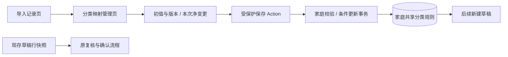

> 由 scope skill 于 2026-10-09 生成
> 状态：已批准 2026-10-09

# 重新编辑已保存的导入分类映射

## 目标

为家庭提供不依赖文件上传或待处理草稿的分类映射管理入口，能够找到之前确定的规则并重新选择其目标，减少错误规则在后续账单导入中的重复使用。

## 决策基线

### 需求边界

- 在现有 `/records/import` 页面增加“管理分类映射”入口；未上传文件、待确认草稿和导入完成状态下均可进入。管理页面提供返回导入页的入口，保持移动优先并同步中文、英文文案。
- 编辑对象为当前家庭已保存的随手记、微信支付、支付宝、招商银行分类映射，包括实际分类和“忽略”规则。列表展示来源、收支类型、原始主分类/子分类及当前结果；来源、类型和原始分类为只读识别信息，编辑操作只改变规则目标。
- 目标可以选择现有启用、类型匹配的分类，或“忽略”。无规则时展示空状态；既有目标分类停用时仍展示其原名称，但不能将停用分类作为新的目标保存。空选项不代表忽略或清除规则。
- 映射继续由同一家庭成员共享。修改仅影响后续新建草稿，以创建流程实际读取时已提交的规则为准；不回写任何现存草稿的行、归属成员、决定或汇总，也不修改已经入账的交易。新建草稿继续沿用原导入保护和去重规则。
- 保存以本次呈现的初始结果为基线，只提交最终选择与初值不同的规则；未修改、改回初值或无修改保存均不重写共享规则。管理页和现有草稿映射表单均保持这一边界。
- 保存成功后刷新规则并建立新基线；校验或事务确定失败时，保留用户选择、初值及并发校验信息，允许重试。提交中任一规则无效或发生冲突时整次保存不生效。通信异常或成功响应丢失时，保留选择并提示刷新核实结果，不自动重复提交，也不能声称服务端已回滚。
- 同一规则自页面读取后被其他页面或家庭成员修改时，拒绝旧版本覆盖并提示刷新后重新编辑。未修改的规则不参与保存或冲突判断，其他分组的并发变更不阻碍本次有效修改。

### 技术决策

- 复用 `ImportCategoryMapping` 的 `id`、`categoryId`、`updatedAt` 和现有家庭内唯一约束，无数据库迁移：记录存在且分类非空表示实际分类，分类为空表示忽略。新增管理读取/保存职责与草稿行更新职责分离，管理保存只写共享规则表。
- 管理页面和 server action 使用 `requireAppSession()`；服务端再校验 session 成员属于当前家庭。查询和更新始终使用 session 派生的 `householdId`，不能以客户端提供的家庭、成员或来源信息授权。
- 客户端提交规则 ID、目标分类或明确忽略，以及页面读取时的并发校验信息。服务按规则 ID 和当前家庭定位已存在的支持来源规则，从数据库记录确定交易类型；不通过客户端可变分组字段或重新拆分 `mappingKey` 定位。
- 并发校验以页面初始版本为依据，在同一事务中完成现有规则、版本、启用分类和收支类型校验及条件更新；事务设置明确 timeout。仅提交的变更参与校验，任一无效或条件更新不匹配即整体回滚。未修改请求不产生数据库写入。
- 现有 `updatedAt` 为毫秒精度，作为初始版本使用时，每次共享规则写入都必须从当前持久化版本产生严格更大的下一版本，不能只依赖 Prisma 自动更新时间。管理保存与既有草稿的规则保存都遵守这一机制；锁定或条件更新保护版本生成，多个规则采用一致的锁定顺序。复用现有字段，保留草稿明确修改分组时的产品行为。
- 对客户端返回固定、可翻译的成功、失败或冲突结果，不暴露数据库错误、其他家庭规则或私有配置。分类名沿用 `getCategoryDisplayName`；规则明细只在受保护页面展示，不加入 URL、客户端日志或持久化客户端存储。
- 现有文件解析、分类分组定义、草稿状态、成员归属、`amountFen`、`Asia/Shanghai`、来源字段及包含软删除记录的同源去重规则继续使用原实现。管理入口不改变 `/records/import` 上传入口和草稿内明确修改分组的保存行为。
- 本次不更新 wiki。Spec 与实现归入同一个 feature 提交；实施完成后按仓库规则同步 feature 版本、完整验证、安全审查、合回并推送 `master`，再运行正式服务脚本与健康检查。当前基线版本为 `1.37.0`，实施收尾时依最终基线计算版本。

## 设计视图

### 功能设计

用户从“导入记录”页进入“管理分类映射”，页面按来源和收支类型组织家庭已保存的规则，展示原始分类与当前映射结果。无需先上传文件，已经确定实际分类或忽略的规则都能找到。没有保存过规则时，页面说明规则会在导入分类映射保存后出现，并可返回导入页。

用户将某些规则改为实际分类或忽略，再保存本次修改。成功后列表显示最新结果，并说明这些规则用于后续新建草稿；从待确认草稿进入时，该草稿保留已有复核结果。确定失败保留当前选择供重试；结果未知的通信异常提示刷新核实；冲突提示刷新以取得最新规则后再编辑，不能自动用旧选择覆盖新版本。停用目标保留可识别的原名称，替换选项仍限于有效分类。

### 技术设计

#### 整体方案

管理页位于受保护的 `/records/import/mappings`，由 `/records/import` 提供入口。服务端读取当前家庭的支持来源规则和分类展示信息；客户端表单保存初值、版本和当前选择，生成净变更集。独立管理 action 取得可信 session 后调用规则服务，服务只修改 `ImportCategoryMapping`。草稿创建继续读取共享规则，既有草稿继续读取已保存的行快照。

#### 关键结构

管理读取模型包含稳定规则 ID、来源、交易类型、原始分类、当前目标及可用于条件更新的初始版本。忽略继续使用 `categoryId: null`，未选择不能转换为 null。当前目标的显示信息与可选有效分类分别读取，以保留停用分类的可识别状态。

管理变更集只包含已存在规则的目标变更及初始并发信息。服务端读取时按家庭收敛；保存时再次验证成员与规则归属、目标和初始版本，不能只依靠 UI 限制。共享规则的版本生成由管理保存与草稿保存共同使用，保证同毫秒或时钟回退时仍能识别旧版本。保存成功后重新读取以建立服务端确认的基线；确定失败和结果未知均不自行前移基线。

#### 实现流程

1. 导入页在所有状态展示入口；管理页验证有效 session 和家庭成员后加载共享规则及显示/可选分类。
2. 表单按初始结果显示选项，保留原始分类识别信息；提交时省略未改、改回初值及无选择的规则。无净变更直接结束，不发布默认值。
3. Action 校验输入形状；规则服务在家庭作用域事务内校验全部变更及初始版本，再条件更新目标。失败或冲突整体回滚，以固定结果返回表单。
4. 成功刷新列表与基线；失败保留选择并展示提示。新草稿在既有创建流程中读取新的共享规则；现存草稿和交易没有管理保存产生的写入。

### 预估改动面

- `src/app/(app)/records/import/`：管理入口、新管理页面和独立 action，保持当前上传、复核、完成页面行为。
- `src/lib/imports/`：家庭作用域规则读取/条件保存服务、净变更逻辑，以及管理与草稿共用的规则版本更新机制；按现有模式组织模块，保留草稿行更新职责。
- `src/components/`、`src/lib/i18n.ts`：移动端管理表单、空状态、保存/失败/冲突反馈与双语分类展示。
- `tests/unit/`、`tests/integration/`、`tests/e2e/`：净变更、权限与事务并发、规则复用与既有数据不变、独立入口和双语浏览器验证。Wiki 目标为不更新。

## 验收

- 未上传、待确认与已完成状态进入管理页 → 均不要求创建草稿，能够返回导入页；浏览器端到端证据。
- 家庭四来源真实分类与忽略规则 → 列表按来源/类型可识别，原始主/子分类及当前目标准确，空分类有明确占位；服务集成与页面/浏览器证据。
- 规则改为另一有效分类、实际分类改为忽略、忽略改为实际分类 → 保存后重新打开结果正确，后续新草稿应用对应规则；四来源真实数据库集成及浏览器证据。
- 从现存草稿进入修改，且家庭存在其他待确认/完成草稿及已入账或软删除交易 → 所有既有草稿行、成员归属、状态、决定和交易保持不变；真实数据库保存前后对比及浏览器证据。
- 新草稿使用修改后的规则 → 原全额退款、受保护退款、银行默认跳过、无效行、同源重复和疑似重复保护仍有效；复用并补充导入集成回归。
- 未修改保存、修改后改回初值、修改规则 Y 时规则 X 被其他页面更新 → 不写未改规则、不产生无关冲突、不覆盖 X；纯逻辑、真实数据库和双页面浏览器证据。
- 同一规则被另一管理页面或既有草稿保存修改后，旧管理页尝试保存 → 返回冲突，整次变更不生效；同毫秒和时钟回退下版本仍严格递增，刷新后使用最新版本可保存；真实数据库并发、重复/回退时钟和双页面浏览器证据。
- 请求包含其他家庭/不存在规则、重复 ID、伪造版本、停用或不存在分类、类型不匹配分类、空目标或异常输入 → 服务端拒绝，其他同批规则也不改变，不泄露他人规则；真实数据库集成与 action 边界证据。
- 校验或数据库更新确定失败后重试 → 所有规则原子保留，选择和初值不丢失，重试能成功且未修改规则不被重新发布；真实数据库回滚及浏览器失败注入证据。已提交但成功响应丢失 → 选择保留、提示刷新核实，不自动覆盖服务端结果；浏览器响应丢失注入及数据库提交对比证据。
- 规则目标停用、尚无规则、中文与英文、移动端使用 → 原目标仍可识别，停用分类不可作为新目标，空状态及按钮反馈清楚，入口和表单可操作；页面与浏览器证据。
- 未登录、AppSession 过期/撤销或 session 成员不属于家庭 → 管理读取和保存均拒绝访问；认证与越权回归证据。
- 最终实际变更 → 完整 lint、unit、integration、e2e 与必要构建检查通过，按 `skills/billboard-security-review/SKILL.md` 输出 Findings、Verification、Residual Risk；核验版本、任务文件、远端 SHA、生产镜像与健康检查，已有生产库不 seed。
