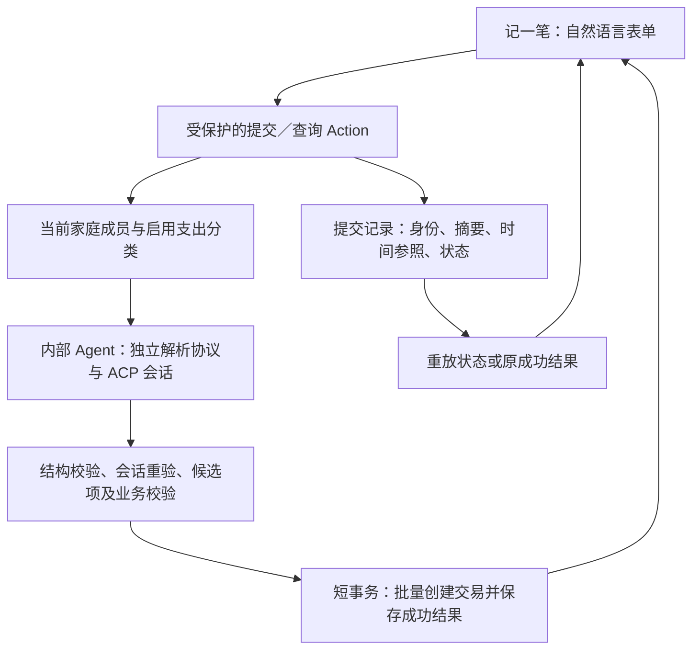

> 由 scope skill 于 2026-10-13 生成
> 状态：已批准 2026-10-13（用户批准已按 Review Spec 建议修订的成稿）

# 自然语言支出记账

## 目标

在“记一笔”中提供一个文本框和“导入”按钮，让家庭成员用一段自然语言描述一笔或多笔支出，由 AI 提取记账信息并自动入账，减少逐笔填写金额、分类、日期和成员的操作。

## 决策基线

### 需求边界

- 入口位于 `/add`，通过“自然语言／手工填写”切换。初次进入沿用手工填写；自然语言模式的输入区域只有一个多行文本框和一个“导入”按钮，可显示简短示例、处理状态及结果。适配手机键盘，文案同步中英文。
- 一次输入支持多笔人民币支出。只新增支出；收入、退款、转账、已有记录修改或删除等要求返回范围提示。混入不支持的交易或无法识别的交易片段时，整段不入账，不静默跳过。
- 金额必须有明确依据，不能猜测缺失金额或把“大概几十元”转换成确定数值。AI 为每笔选择现有启用的支出分类，并提取简短、忠于原文的备注；不创建分类或家庭成员。
- 日期和时间均未给出时，使用服务端首次受理本次提交的上海时间。明确日期及“今天”“昨天”等相对日期按同一参照解释；只给日期时使用该日 `00:00`，只给钟点时使用参照日期。日期含歧义时提示修改，不自行选取某一天。
- 未明确付款成员时，归属当前登录成员；明确另一位家庭成员付款时，识别为该成员。收款人、礼物接收人和同行人不等于付款成员，例如“给老婆买衣服 100 元”仍默认归当前登录人。归属只能来自当前家庭，创建人始终为实际提交者。
- 点击“导入”后直接识别并记账，不增加入账前预览或二次确认。所有支出识别和校验通过后一次写入；任意一笔缺失、含糊、不支持或校验失败，整段不写入，保留当前页面原文并说明需修改的片段。
- 成功后清空输入，显示本次入账笔数及人民币合计，支持继续输入；通过既有记录页编辑或删除。提交期间及结果未确认时冻结提交快照；明确失败后可以修改，网络中断等未知结果必须先确认原请求。
- 单次输入上限 2,000 个字符、20 笔支出。超限时提示缩短或分次输入，不截断原文、记录或模型输出后继续入账。
- 现有手工填写、文件导入、家庭汇总、记录筛选及编辑删除行为继续适用。自然语言输入属于 AI 辅助手工记账，按钮沿用用户指定的“导入”；交易的 `source`、`sourceFingerprint`、`sourceImportedAt` 保持空值。文件导入仍使用 `/records/import` 及原有来源、草稿和映射规则。

### 技术决策

- 复用现有独立 `import-agent` 容器、Codex ACP 运行器和服务端模型配置，为自然语言解析增加独立请求／响应协议与内部端点。两种任务共用认证、单任务互斥和进程清理机制，分类建议的协议及数据范围继续独立维护。
- 自然语言任务允许发送本次输入、上海时间参照、必要的启用支出分类和当前家庭成员显示名称；分类和成员使用任务内匿名 ID，并标明当前提交者。输入中本来包含的金额、日期和人物描述会随文本发送给已配置的模型服务。服务端不附加历史账本、原始账单、真实数据库 ID、账号、会话或凭据。
- 输入文本及所有候选名称均是不可信数据。Agent 只输出结构化解析结果，不获得数据库、文件、shell、网络工具或其他执行权限；复用现有隔离环境，不新增公开端口、认证方式或供应商管理界面。
- 应用负责会话、家庭和数据校验。调用前及落库前均检查有效、未过期且未撤销的 AppSession；从 session 派生家庭和创建人，匿名成员／分类必须映射回当前仍有效的候选项。
- 金额持久化为正整数 `amountFen`，精度和范围符合现有人民币金额规则及数据库整数限制。所有日期解析和范围判断统一为 `Asia/Shanghai`。模型返回 JSON 合法不能替代金额、日期、成员、分类和业务范围校验。
- 新增最小的持久化提交记录，用当前家庭、提交成员和客户端请求 UUID 定位一次操作，保存已受理请求的规范化输入摘要、首次受理时间、处理状态以及结果，或尚未受理请求的终态关闭标记。该记录用于并发互斥、结果确认和安全重试，不提供历史聊天或任务管理页面。
- 一次提交的交易和成功结果在同一数据库事务中批量写入。AI 调用位于事务之外；处理中的请求使用有时限的占用和可区分的尝试标识，只有当前有效尝试可以提交。进程退出或请求超时不能留下永久占用，过期尝试的迟到结果必须被拒绝。
- 已有输入摘要的请求，相同标识及相同输入返回原有状态或结果，相同标识携带不同输入报冲突。成功及已经对页面声明“确定未入账”的失败均为不可重新执行的终态；尚未受理的关闭标记没有输入摘要，后续同 UUID 携带任何文本均只返回已关闭的失败结果。已成功的请求在记录被编辑或软删除后仍返回原提交结果，不重新创建交易。不同次主动提交允许相同消费文本，不按文本内容永久去重。
- 查询未找到本人的请求记录时，必须先在数据库中原子建立终态关闭标记，才能告知确定未入账并解除页面冻结。关闭与首次受理使用同一身份／请求键的数据库互斥和唯一约束，覆盖尚无记录可加行锁的情况；首次受理先完成则查询返回已有状态，关闭先完成则迟到的首次提交不得执行。正常清理不得重新开放已关闭 UUID。
- “需要修改”的终态失败保存固定错误码及经校验、有界的问题类型和原文起止偏移。偏移对应本次提交的规范化文本，页面用同一规范化规则定位保留的快照；查询及重试重放这些信息，不重新解析。刷新丢失原文后只显示固定错误提示，不伪造片段或还原原文。
- 原文和提交快照仅在本次请求及当前页面内存中保留，成功后清除；服务端提交记录不长期保存原文或模型原始输出。当前标签页可以按成员隔离暂存未确认的请求标识，以便刷新后查询结果，但不新增原文、多笔明细或模型结果的浏览器持久化副本，也不承诺跨刷新恢复原文。
- 复用现有有界运行机制：Agent 最多运行 45 秒，应用等待最多 55 秒；与分类建议共享繁忙状态。原始输入、模型响应、金额、备注和成员名称不得进入 URL、应用事件、客户端诊断、日志或外部分析。错误使用固定代码及本地化提示，必要的原文片段只在当前授权页面展示。

## 设计视图

### 功能设计

用户进入“记一笔”，切换到自然语言，输入例如“昨天老婆付了买菜钱 50 元，我今天打车 20 元”，点击“导入”。页面立即显示处理中并冻结本次内容。识别后，应用校验两笔支出及各自归属，在一个事务中保存，返回“已记 2 笔，合计 ¥70.00”并清空文本框。用户继续输入下一段，或通过现有导航查看记录。

输入“午饭 35 元，打车忘了多少钱”时，返回打车金额缺失，交易数量保持不变，原文仍可编辑。该失败的首次响应丢失时，保留原文的页面可通过查询或同 UUID 重试取回问题位置，继续准确提示缺失片段。服务繁忙、模型认证失效、超时或无效输出在能够确定没有入账时返回明确失败；连接中断、页面刷新或已有同请求正在处理时进入结果未确认状态，按钮用于查询／重试同一次请求。确认成功后清空输入，确认失败后解除冻结；不能把未知结果当成明确失败并自动换新请求。

切换输入方式不会提交内容，也不丢弃原手工表单已有草稿。自然语言当前页面的未提交文本在切换后可恢复；离开页面或刷新不承诺恢复原文。若当前标签页还有未确认的请求，恢复到自然语言模式并先查询状态；请求尚未受理时，服务端先原子关闭该 UUID，再提示未入账并允许重新输入，不永久等待，也不以简单的“查无记录”直接解冻。成功提示与可修改问题均在当前页面内展示，不增加聊天、分类映射或逐行复核流程。

### 技术设计

#### 整体方案

表单只提交文本、请求标识和界面语言；家庭、创建人、时间参照、候选项及来源字段由服务端控制。自然语言业务服务组合请求管理、最小化出站数据、解析结果校验和原子入账，不调用文件导入草稿或分类映射的保存流程。

Agent 内部端点与现有分类端点使用相同的内部认证及共享互斥。运行器按任务类型选择固定协议和指令，保留临时 HOME、独立认证、无工具能力、输出上限、超时、取消及进程树回收。模型配置继续来自专用服务进程；客户端不能指定模型、推理强度或任意提示词。

#### 关键结构

- 解析请求：协议版本、长度受限的原文、首次受理的上海时间参照、匿名分类候选、匿名成员候选及当前成员标记。
- 解析响应：显式区分“全部识别成功”与“需要修改”。成功包含有界的支出数组，逐笔给出原文依据、金额、日期／时间信息、分类、成员及备注；需要修改则给出可定位的原文片段和问题类型，不携带可直接入账的部分结果。应用校验引用范围、完整结构、候选 ID、类型、金额和日期，拒绝未知字段、越界依据或无依据的条目；不合并两类结果。
- 提交记录：当前家庭／提交者与请求 UUID 构成唯一身份键；已受理请求保存输入摘要、首次受理时间、处理状态、当前尝试及截止时间、成功交易 ID 列表、笔数和合计，或终态错误码及经校验的问题列表。问题只保存白名单类型和原文起止偏移，不保存片段内容；格式、数量、偏移边界和与规范化输入的关联均须通过校验。尚未受理的关闭标记只保存身份键、关闭时间和固定失败码，不伪造输入摘要或时间参照。终态不可被重试覆盖，失败不保留原始模型响应。新增结构只服务该功能，不回填历史交易，也不复用金融来源指纹作为请求 ID。
- 页面结果：处理中、明确失败、需要修改、成功或结果未确认；携带必要的请求关联信息及本次结果。处理／未知状态不能接受新快照；成功及已确认失败才结束本次操作。

#### 实现流程

1. 表单捕获不可变文本快照并生成请求 UUID。服务端验证 session、文本长度及请求格式，以家庭和提交者定位请求键；已有输入摘要时先核对并拒绝冲突，再重放终态或返回处理中。尚未受理的关闭标记直接重放已关闭失败，不补录摘要、不重新打开请求；新请求首次建立记录也必须参与该请求键的数据库互斥。
2. 新请求建立首次受理时间并取得有时限的处理资格。只有尚未进入终态、占用已过期且重试携带相同原文快照的同请求可以重新取得资格，继续沿用首次输入摘要和时间参照；并发请求不能同时获得可提交资格。查询接口只访问当前家庭及提交者自己的请求：仍有效的尝试返回处理中；占用已过期时，在同一请求锁下关闭旧尝试、原子转为终态失败；没有记录时，在同一请求键下原子建立关闭标记。若首次受理已经赢得竞争，查询必须重新读取并返回已有状态，不覆盖它。只有关闭结果成功提交后才明确告知未入账；该关闭与首次受理、重试抢占互斥，不能仅凭请求 UUID 重启模型解析。
3. 服务端批量读取当前家庭成员与启用支出分类，以匿名候选构造解析输入。Agent 在事务之外执行；不能识别的交易片段必须作为问题返回，不能自动删除片段后返回成功。
4. 返回后重新确认 AppSession、成员归属和分类状态，完成协议与业务校验。确定失败时结束当前尝试，将固定错误码及已验证的问题类型／偏移一起保存为终态后再返回；无可靠问题位置的错误只返回固定提示，不保存或展示未验证的模型片段。如果该尝试已失去处理资格，其响应不能变更请求或交易。
5. 全部通过后，短事务锁定并确认当前请求状态及尝试资格，批量创建所有交易，同时保存不可变的成功结果。使用有界批量写入和明确的 transaction timeout，不逐笔重新查询、逐笔独立提交，也不在事务中等待模型。
6. 提交成功后使首页与记录页数据失效，并按现有模式 best-effort 写入不含财务明细的活动事件；幂等重放不重复写事件。缓存刷新或事件写入失败不能把已入账结果改成保存失败。
7. 表单接到匹配请求的成功结果后清空原文及待确认标识。无法确认时保留同一请求标识，查询或携带原快照安全重试；刷新后的恢复只依赖该标识及服务端状态，原文丢失时只查询，不重启解析。页面仍持有匹配快照时，用重放的问题类型和偏移显示修改位置；没有原文时显示固定失败提示。对外确认未入账前，过期尝试或尚未受理的 UUID 必须先被原子关闭；页面只有收到成功或终态失败才解除冻结。终态失败后用户重新导入使用新请求，旧 UUID 的迟到首次提交或重试始终重放失败，防止与新操作交叉写入。

### 预估改动面

- `src/app/(app)/add/`、相关表单组件和 `src/lib/i18n.ts`：输入方式切换、自然语言表单、提交／查询 Action、状态处理及双语文案。
- `src/lib/transactions/`：独立解析协议、候选匿名化、结果验证、提交状态管理及批量创建业务逻辑；复用现有金额、上海时间和权限规则。
- `prisma/schema.prisma` 与新增 migration：最小提交状态结构、唯一约束及必要索引；现有交易和文件导入数据无需回填。
- `agent/`：增加自然语言内部端点、任务协议与 prompt，复用受限 ACP 运行器。仅做两个现有任务所需的共享，不引入通用 Agent 平台。
- unit、integration、e2e 及现有 Agent fixtures：覆盖解析约束、权限、批量原子性、会话中途失效、并发、网络未知结果和既有功能兼容；更新需要清理新提交记录的测试隔离逻辑。
- README 的 `/add` 功能和 AI 数据范围说明；实施时新建已确认的 `docs/wiki/natural-language-accounting.md`，并更新 `docs/wiki/wiki.md` 索引。
- 最终 feature 按同步后基线版本递增 `Y` 并将 `Z` 置 `0`。spec 与实现合入同一 feature 提交；当前 spec 审阅阶段不单独升级版本或提交。

## 验收

- 手机及桌面切换自然语言模式 → 只有文本框与导入按钮作为输入控件，中文／英文、键盘避让、处理中和结果提示可用，手工草稿可恢复；组件及 e2e 证据。
- 一段明确包含多笔支出 → 每笔金额、日期、成员、现有分类和备注正确，一次入账，成功笔数／合计正确，首页与记录页可见；协议、数据库集成及 e2e 证据。
- 未写日期或成员、明确另一成员付款、人物仅为收款人或受益人 → 按决策基线归属；只写日期、相对日期及跨上海午夜重试使用同一时间参照；单元、集成及合成真实模型样例证据。
- 缺失／含糊金额、无法确定日期或成员、收入／转账等混入、超过字符或笔数上限 → 指出问题且整段交易数量不变，原文在当前页面保留，修改后可重新提交；单元、集成及 e2e 证据。
- 模型返回未知成员／分类、停用或类型不符的分类、错误金额精度／范围、不合法日期、越界原文依据、非法 JSON 或额外字段 → 拒绝整次结果且不写账；协议和真实数据库集成证据。
- 伪造家庭、创建人、来源或请求标识，跨家庭／跨成员查询他人的提交 → 被拒绝且不泄露结果；有效 session 中途过期或撤销、候选成员或分类中途变化 → 提交前重验失败，整批不写入；安全集成证据。
- 事务中模拟任意一笔写入失败 → 无部分交易、无成功提交结果；成功时交易和结果同时存在，来源字段为空、金额为整数分，文件导入来源不变；数据库集成证据。
- 双击、并发重试、响应丢失后重试及刷新查询 → 同次提交至多生成一批记录，返回原结果；同 ID 不同输入冲突，记录编辑／软删除后重试不再创建；并发集成和弱网 e2e 证据。
- 浏览器暂存 UUID 后，首次提交尚未建立服务端记录即断网并刷新 → 查询原子建立关闭标记后返回确定未入账，页面可恢复输入；关闭与迟到首次提交竞争时，要么关闭先完成且旧 UUID 永不执行，要么首次受理先完成并返回已有状态，不能同时宣告未入账又写账；同 UUID 的关闭结果对任何迟到文本保持终态；并发集成和断网／刷新 e2e 证据。
- 需要修改的首次响应丢失，页面仍持有原文快照 → 查询或同 UUID 重试重放问题类型和有效偏移，仍准确定位需修改片段；刷新丢失原文后仅显示固定提示，不重新解析、不泄露原文；越界／无效问题位置不被保存或展示；协议、集成及 e2e 证据。
- 占用过期、服务重启或旧尝试迟到 → 未结束的操作可持原快照安全恢复，旧尝试不能写账或覆盖新结果；刷新丢失原文后可查询并原子关闭过期请求；一旦终态失败并允许新操作，旧 UUID 的重试永不再执行；查询关闭与重试抢占竞争仍至多写入一批；时钟／进程边界及数据库集成证据。
- 相同文本的新请求 → 可正常记录另一笔真实消费，不把内容相同当作全局重复；数据库集成证据。
- Agent 繁忙、认证失效、超时、取消或异常退出 → 时限内回收进程，界面区分明确未入账与未知状态，保持可查询／重试；ACP fixture、HTTP fixture 和 e2e 证据。
- 捕获出站 HTTP、日志、诊断和浏览器存储 → 仅模型请求含获准的本次文本及候选信息；无历史账本、真实数据库 ID、账号或会话凭据外发，无原文或批量明细进入日志、URL、事件及客户端持久化存储；隐私集成和安全审查证据。
- 真实模型链路 → 用合成单笔、多笔、成员／日期和信息缺失样例验证新 ACP 解析协议；已有分类推荐合成样例继续通过，不用真实账本做 smoke；脱敏运行证据。
- 最终实现 → `npm run lint`、`npm run test:unit`、`npm run test:integration`、`npm run test:e2e` 全部通过，完成适用构建／迁移检查与安全审查 Findings、Verification、Residual Risk；遵循已确认 Git 偏好合回并推送 `master`，核对远端 SHA 后部署及健康检查，已有生产库不执行 seed。
