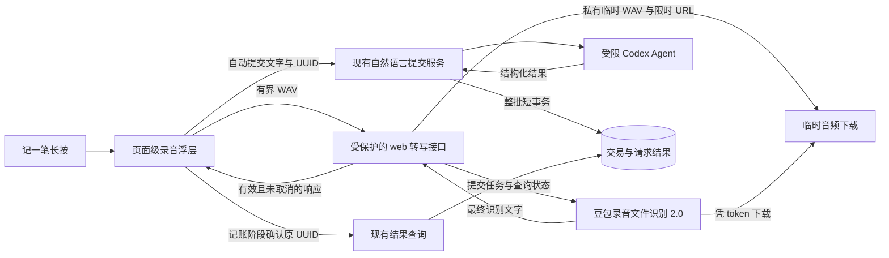

> 由 scope skill 于 2026-10-13 生成
> 状态：已批准 2026-10-13；用户在独立 Spec review 后明确批准实施。2026-10-14 用户明确采用录音文件识别 2.0，以下技术决策据此更新；同日用户确认实际入口为 FRPC 与域名转发服务，未部署 nginx。

# 长按语音记账

## 目标

让家庭成员在当前页面长按“记一笔”描述收支，松开后自动完成语音转写、AI 解析和记账，在原地查看结果，减少切换页面和手工填写的操作。

## 决策基线

### 需求边界

- 现有“记一笔”导航入口增加长按交互，移动端触摸与桌面端主指针使用同一行为。短按仍进入原记账页；长按打开当前页录音浮层，不导航、不清空底层页面的手工或自然语言草稿，也不改变筛选条件。
- 按住期间录音，松开自动提交，无转写预览确认或二次入账确认。上滑进入取消状态，松开取消且不上传；回到有效区域再松开可提交。单次最多 60 秒，到限立即停止采集并明确提示，等本次按压松开后才提交，仍可上滑取消。
- 首次使用通过浏览器申请麦克风权限。只有权限获准且本次按压仍有效时才能开始采集；等待授权期间已松开或取消，迟到授权不能启动录音或提交，提示再次长按。不支持录音、权限被拒绝、设备不可用时给出明确提示，保留原有文字与手工入口。
- 浮层表达“正在录音 → 正在识别 → 正在记账 → 记账结果”，展示录音时长及取消提示。录音时页面隐藏、失焦、指针取消、浮层关闭或组件卸载均取消本次录音并释放麦克风，不把意外中断当作松开发送。补充键盘可操作的录音开始、停止提交及取消操作，不要求用户只能执行长按手势。
- 语音转写接入火山引擎豆包语音，用户已有豆包语音控制台创建的 API Key。转写文字自动交给现有自然语言 Agent；一次支持人民币收入、支出及混合收支，沿用 2,000 字、20 笔、成员归属、退款新增收入及既有不支持场景，不新增分类或成员。
- 全批通过校验才入账；成功显示总笔数及实际包含类型的收入／支出合计，在当前页面反映新的账本结果。信息不完整或其他明确记账失败时，浮层保留本次转写文字及问题提示，可修改文字后主动重新提交，也可重新录音。修改后的文字作为新请求，不追加到原文字草稿。
- 空录音、静音、无可识别文字、超限、转写错误均不发起记账。转写阶段关闭浮层会取消该次处理，迟到响应不能自动发起记账。已经进入记账阶段后，关闭浮层仅隐藏状态，不表示撤销交易；处理或结果未知时不能发起另一笔 AI 记账，重新打开浮层可以确认原请求结果。
- 音频与转写文字仅临时处理；刷新不恢复录音或原文。转写阶段刷新后没有待执行记账；记账阶段刷新按已有成员作用域 UUID 恢复结果确认，不能把网络错误宣告为确定未入账。中英文 UI 文案同步维护。

### 技术决策

- 采用“浏览器录音 → web 转写接口 → 豆包语音 → 浏览器收到文字 → 自动提交现有自然语言 Action → Agent 解析 → 应用事务入账”的两阶段流程。第一阶段服务端只转写，不能调用记账或创建交易；第二阶段无需用户再点击。两个请求各自有时限，转写不占用现有 Agent 45 秒执行／55 秒等待和记账 75 秒租约。
- 火山转写改用录音文件识别 2.0：固定 `POST https://openspeech.bytedance.com/api/v3/auc/bigmodel/submit` 提交，再用同域 `/api/v3/auc/bigmodel/query` 查询；认证为 `X-Api-Key`、资源为 `X-Api-Resource-Id: volc.seedasr.auc`，两步使用同一个随机 `X-Api-Request-Id`，提交带 `X-Api-Sequence: -1`。服务端把已校验 WAV 保存为私有临时文件，以 `audio.url` 提交限时 HTTPS 下载链接，明确 `format: wav` 和 `request.model_name: bigmodel`。受理成功不代表完成；队列和处理中状态在原有 30 秒总预算内轮询，超时返回固定错误且不记账。官方异步服务不承诺秒级延迟，需真实短录音验证。只有最终成功业务码和有效非空 `result.text` 才能进入记账。
- 浏览器内生成单声道、16 kHz、16 位 PCM WAV，采样数量限制对应最多 60 秒，上传总请求体限制为 2 MiB；由实现选择浏览器采集与重采样细节，不引入服务端音频转码工具。服务端独立校验 WAV 结构、声明及实际数据长度、编码、采样率、声道和时长，不信任扩展名、MIME 或客户端计时。格式不能有效生成时给出不支持提示，不能伪装格式或静默截断。
- 新增受保护的同源 POST 转写入口，调用 `requireAppSession()`，从 session 派生家庭和提交成员，处理前及返回转写前重新检查有效会话；同源检查、流式请求体上限、独立 30 秒临时存储及供应商提交／查询总时限、有界响应体和同成员调用频率／并发限制在服务端执行。拒绝任意外部 URL、客户端文件路径及客户端提供的家庭或成员身份。
- 配置 `VOLCENGINE_ASR_API_KEY` 和 `VOICE_AUDIO_PUBLIC_ORIGIN` 只注入 web 服务；真实值仅放在未跟踪的私有 env 或部署配置中。下载地址只基于配置的 HTTPS 根 origin 构造，不信任客户端 Host、URL 或路径。服务端固定供应商端点及资源，不新增页面供应商设置。使用 API Key 所属项目开通的录音文件识别 2.0，现有 Codex 登录不能替代该凭据；录音只发送给豆包语音，账本分类与成员候选仍仅发送给现有 Agent。请求确需用户标识时使用任务随机标识，不发送 API Key、真实成员 ID、账号或设备标识作为 `uid`。
- 两阶段的状态所有权明确分离。录音和转写操作属于当前页面内存，绑定起始路由及页面代次，具备取消标识且至多一个有效后续回调；站内路由或筛选导航变化主动取消，即使应用外壳未卸载也不能让晚到响应记账。只有转写成功、页面仍有效且开始记账时，才生成自然语言请求 UUID、冻结文字快照并写入现有待确认 UUID 存储。语音自动记账必须先确认 UUID 可写入并读回；存储不可用则保留转写文字、提示失败且不发起账务请求，不能静默降级后承诺刷新恢复。现有文字入口的存储不可用行为不在本次范围内改写。转写阶段禁止调用 `queryNaturalLanguageEntry`，避免其对不存在请求创建 `NOT_ACCEPTED` 终态。
- 语音与现有文字自然语言入口共用最小请求控制器及同成员、同标签页的占用与待确认状态。长按被接受即取得内存占用令牌，覆盖授权、录音和转写；期间文字表单保留草稿但禁止提交。取消／明确转写失败释放占用；ASR 返回只有仍持有效令牌时，才能原子交接为记账 UUID，不留下允许另一入口抢先提交的空隙。任一入口有记账待确认时，另一入口不能开始新任务。原文字草稿仍由其表单持有，语音草稿独立存于内存；恢复逻辑只能有一个所有者。
- 记账阶段复用现有家庭＋提交成员＋UUID 幂等身份、文字哈希、数据库锁、租约和不可变终态。响应丢失后只查询原 UUID；不能重新转写并用新 UUID 自动提交。明确失败后的文字修改或重新录音由用户主动发起新请求；重复终态查询不产生交易或创建活动。缺省日期与相对日期继续使用自然语言请求首次受理的上海时间，客户端不提供账务时间参照。
- Agent 继续仅接收本次文字、现有收支分类和当前家庭匿名成员候选，不增加文件、命令、数据库或网络工具权限。交易使用正整数分 `amountFen`，应用在 AI 返回后重验 AppSession，并在事务内重验分类和成员，整批交易与成功摘要一起写入；语音记录仍属于 AI 辅助手工输入，来源三字段为空。本方案不需要修改 Prisma 表结构或持久化转写任务。
- 浏览器只在本次处理内存中保留音频和转写，结束后释放录音轨道、音频上下文、Buffer 和对象 URL；不新增录音留存、浏览器正文存储、日志正文或诊断附件。服务端临时 WAV 位于系统临时目录的应用私有子目录；文件 0600、目录 0700，最多 16 个活动文件，总体有界。成功、失败、取消或 45 秒租约到期均撤销下载能力并删除文件，异常退出的遗留文件由重启清理；生产临时目录使用容量受限 tmpfs。Agent 不接收文件、路径或凭据。此规则不冒充供应商侧的数据保留承诺，也不能撤回供应商已经下载的音频。
- 新增 `/api/voice/audio` 仅供供应商 GET／HEAD 下载；使用 256 位随机 token 授权当前单个文件，不要求供应商提供用户 cookie。token 不含家庭、成员或文件路径，不返回浏览器；不存在、过期或已撤销时统一 404。响应禁止缓存并设置内容类型与隐私响应头；实际域名转发服务、其他前置代理和 Next 开发日志不得记录此能力 URL，不开放目录列表或任意文件访问。
- 保持用户确认的 HTTPS 根域名转发 → frps 远端端口 → frpc → 本地 loopback `3000` → web 链路，不要求部署 nginx。由应用响应设置 `microphone=(self)`，保留 camera／geolocation／payment／usb 禁用；实际前置服务不能覆盖为禁止麦克风。上传限制须允许有界录音且不能收紧既有账单导入范围。同步示例和 runbook，nginx 文件仅作为可选入口配置；web 及 OPS 端口、现有 frp 路由和 Agent 无公网端口约束不变。缺少安全上下文或权限时给出可恢复提示。转发服务的响应头透传、回源请求头和传输保护、音频下载可达性及能力 URL 日志策略须独立核验，不能由应用配置推断已满足。

## 设计视图

### 功能设计

用户停留在家庭看板，长按“记一笔”，浮层出现计时和取消提示；说出“工资到账 8000 元，午饭花了 35 元”后松开。浮层先显示识别中，再显示记账中，最后显示“已记 2 笔，收入 ¥8,000.00，支出 ¥35.00”。关掉浮层仍在原来的时间范围内，看板展示更新后的数据；原页面未提交的表单内容保留。

用户上滑松开、授权等待时已松开或录音中切到后台时，不提交这段录音。到 60 秒显示已停止录音，允许松开发送或上滑取消。系统检测不到可识别内容时提示重新录音，不把静音转成交易。

输入“午饭忘了多少钱”时显示转写文字及缺少金额提示。用户可在浮层改为“午饭 35 元”后提交，成功后清除本次纠错文字。已进入记账阶段但网络断开时，浮层改为待确认状态；恢复网络后确认原 UUID，显示原成功或失败结果，再允许下一次 AI 记账。

自动记账不承诺转写零误差；金额识错但结构合法时，用户仍通过现有记录页的编辑／删除入口纠正。浮层成功结果提供前往记录页的现有操作，不因本功能新增交易修改工具或语音修改历史记录的能力。

### 技术设计

#### 整体方案

页面级提供者挂在应用外壳中，让各页面的导航入口调用同一个浮层。导航组件只识别短按、长按、指针结束与取消；录音资源、起始路由、操作代次及语音草稿由提供者控制。自然语言提交控制器负责临时占用、UUID、冻结快照、终态处理及刷新恢复，文字表单与语音浮层呈现同一待确认结果，不复制两套提交状态机。成功仅通知内存中已知的发起入口清理其本次快照，不能通过全局成功事件清空其他入口草稿。

转写接口在 web 内调用固定供应商，既不接触 Agent 认证，也不承担记账。浏览器自动衔接两阶段，使转写成功但页面已经取消或消失的任务不会偷偷入账；需要恢复的只有已经发起的自然语言提交。最终写账、重放结果、缓存更新及最小活动记录继续走原有服务。

#### 关键状态与接口

| 阶段 | 状态与资源 | 中断后的行为 |
| --- | --- | --- |
| 授权／录音／到限待松开 | 当前操作代次、指针状态、采样和麦克风；无记账 UUID | 取消采集、释放资源；晚到授权不能开启新录音 |
| 转写 | 有界音频上传、AbortController；无记账 UUID | 取消请求或忽略晚到响应；刷新无需查询记账 |
| 记账／处理／未知 | 冻结文字、成员作用域 UUID；sessionStorage 仅 UUID | 隐藏可恢复，查询原请求，不自动发起第二次记账 |
| 需纠错／明确失败 | 本次文字、固定错误类型和经验证偏移；无待确认 UUID | 可修改后新建请求，或关闭丢弃本次语音草稿 |
| 成功 | 已存储的笔数和分类别金额摘要 | 清理本次输入，更新页面数据，允许下一次录音 |

转写端点建议为 `/api/voice/transcribe`，接受有界音频及界面语言，成功仅返回规范化后的文字，错误仅返回本地化可映射的固定类型。对供应商错误码、响应体和请求标识做收敛，不将原始响应、凭据或请求头透传给浏览器。未识别、超限或异常内容不得通过截断凑成一个看似有效的记账输入。

记账保持 `natural-language-entry.v2` 和现有结果能力协商。提取控制器时须兼容已有 `billboard:natural-language-pending:v1:<memberId>` 存储与旧成功结果；即使原录音／文字已丢失，仍可恢复正确的已提交结果。刷新后只有 UUID、没有来源标记时，通过全局待确认结果浮层统一展示，不猜测来自文字或语音、不导航或清空文字草稿；文字表单在同一状态下提供现有结果确认入口。应用更新时旧页面使用原请求规则，不因新增语音入口改写旧终态。

#### 实现流程

1. 导航捕获有效按压，区分短按与长按；录音前检查能力并获取共享占用令牌，绑定起始路由，申请权限并验证操作仍有效。
2. 采集有界音频，在上滑取消、失焦和离开页面等情况下清理；普通松开或到限后的松开生成 WAV，关闭麦克风后开始上传。
3. web 校验会话、同源、调用频率和音频内容，写入私有临时 WAV 并生成限时下载能力；在独立 30 秒总预算内提交豆包任务、查询同一任务并按业务码解析。所有退出路径撤销下载能力并清理文件，再次校验会话后返回有界文本或固定错误。
4. 浮层确认响应属于当前页面代次和未取消的有效占用，再交给共享自然语言控制器。控制器创建并确认已暂存 UUID，原子交接占用后调用原提交 Action；后续解析、校验、原子入账、结果重放遵循原机制。
5. 将成功、需纠错或未知结果展示于浮层，保留需要纠错的当前文字；成功刷新账本数据时不重建底层草稿组件。刷新恢复只依据已经持久化的 UUID 查询；转写阶段没有后台续作。

### 预估改动面

- `src/components/app-shell.tsx`、`bottom-nav.tsx`、`desktop-nav.tsx`、`accounting-input.tsx`、`natural-language-form.tsx` 及新增语音浮层／录音与共享请求控制器：全局入口、手势、资源回收、当前页面保持、纠错与恢复；必要时由已认证布局传递当前成员。
- `src/app/api/voice/transcribe/route.ts` 及新增服务端转写模块、临时文件模块、`src/app/api/voice/audio/route.ts` 和浏览器音频模块：鉴权、有界 WAV 上传、供应商认证／响应校验、超时与取消。新增路径为本次实现目标，现有工程尚无这些文件。
- `src/lib/transactions/natural-language-*` 与 `src/app/(app)/add/natural-language-actions.ts`：仅按复用提交状态与刷新需要做配套调整；维持协议、事务和旧结果兼容，不增加第二条写账通道或 Prisma migration。
- `src/lib/i18n.ts`：完整中英文录音、权限、取消、超限、转写、纠错与待确认提示；首次使用说明录音发送至豆包语音，文字再送现有模型服务。
- `next.config.ts`、`.env.example`、`compose.yml`、`ops/windows/start-production.ps1`、`ops/nginx/billboard-location.conf`、`README.md`、`docs/runbooks/home-network-checklist.md`：按实际启动路径透传私有配置、放行同源麦克风和有界请求。按需要变更，不新增无关启动选项或端口。
- 浏览器音频／手势与供应商适配 unit、真实会话与 ASR HTTP fixture integration、移动与桌面 Playwright：覆盖两阶段中断、数据不留存、待确认互斥和既有手工／文字／导入回归。
- 已确认 Wiki 目标：更新 `docs/wiki/natural-language-accounting.md`、`docs/wiki/wiki.md`；实施首个工作单元同步语音入口、两阶段状态和恢复边界，不新增 Wiki 页面。

## 验收

2026-10-14 发布顺序补充：用户明确要求“先合并主干并推送，并重新更新发布正式服务。我通过正式服务来测试”。本次在已有自动化、构建和代码安全复核通过后先发布；实际公网音频回源、转发服务配置及真机采集改为发布后验收，由 agent 完成可自动检查项、用户在正式服务完成设备实测。保留这些项目的待验状态，不将它们写成已通过，也不再作为本次先行发布的阻塞。

- 当前页短按、长按及上滑松开 → 短按仍导航，长按原地录音，上滑取消无上传／入账；指针结束不额外触发点击，底层路由、筛选和草稿不丢失；触摸及桌面指针 e2e、手势单元与视觉检查。
- 首次授权时已松开、拒绝授权、不支持录音、无设备、失焦／后台／卸载 → 无迟到录音或自动提交，麦克风全部关闭，提示与原入口可用；权限与资源生命周期单元、浏览器证据。
- 达到 60 秒但仍按住 → 停止采集且不继续增加音频，显示明确提示；仅松开提交，上滑仍可取消；边界计时与样本数量单元、浏览器验证。
- 普通话、英语及中英混合的合成收支录音 → WAV 可以经限时下载链接被录音文件识别 2.0 识别，转写自动交给现有 Agent，全批正确入账并显示按方向汇总；真实 ASR 与 Agent 合成音频 smoke、数据库集成和 e2e。移动端 Safari／Chrome 和桌面浏览器必须验证实际录音能力，模拟音频测试不能替代全部真实采集证据。
- 空文件、静音、畸形 WAV、伪造 MIME、超时长／体积、异常采样率／声道、流式超限 → 服务端拒绝且不调用记账；供应商返回静音码、非成功业务码、空文、超长文或畸形响应也不入账；音频边界单元及真实 HTTP 集成。
- 未登录、过期／撤销会话、伪造家庭／成员、跨源上传、任意 URL／路径输入 → 无供应商越权调用或越权返回／入账；转写期间会话失效同样拒绝；会话、隔离、CSRF 与输入集成证据。
- 转写中断网、取消、刷新、站内导航及转写晚到 → 不创建交易，不查询未知自然语言 UUID；应用外壳未卸载但路由已变化也不能继续记账；两阶段竞态集成与 e2e。
- 浏览器存储写入／读回失败 → 语音转写文字仍在当前浮层，但未发出账务请求、不宣称可刷新恢复，给出固定提示；存储拒绝与异常浏览器测试，保留原文字入口降级回归。
- 语音授权／录音／转写时尝试文字提交，或 ASR 返回与文字提交同时发生 → 共享占用阻止第二入口开始，令牌校验与交接只启动一个记账 UUID；取消后恢复文字提交且草稿保留；控制器竞态单元与 e2e。
- 记账响应丢失、并发查询、旧请求迟到、刷新或重复打开浮层 → 原 UUID 至多创建一批，重放原摘要，不重复活动；文本和语音入口互斥恢复，只有旧 UUID 时也能在全局浮层确认，明确未受理关闭机制仍有效；既有并发集成与新增弱网 e2e。
- 缺金额或成员含糊的语音 → 整批失败，显示本次转写及有效问题片段；修改后新 UUID 可以成功，原文字／手工草稿不被覆盖；中英文 e2e 与数据库验证。
- 成功后刷新当前看板或记录页 → 数据更新但时间范围与未提交表单保留；后续记录编辑／删除及退款等语义仍按现有规则，语音记录来源三字段为空；e2e 和数据库集成。
- 浏览器存储、URL、诊断、日志及处理结束后的临时目录 → 仅允许待确认 UUID 和原有最小活动；供应商下载 URL 只在本次服务端调用期间携带随机 token，不向浏览器返回或写日志；结束后无新增录音、原始转写、密钥或供应商原始响应留存；Agent 入参只包含本次文字及既有必要时间参照、匿名分类／成员候选，不包含音频或云端凭据；隐私与清理检查、出站请求检查和安全审查。
- 临时下载入口 → 无效、过期、撤销 token 统一拒绝；不同 token 不能互相读文件，客户端 URL／路径不能改变下载目标，取消／超时／异常完成后文件和能力清理；HTTP fixture 实际下载、文件权限和生命周期测试，并核验真实域名转发服务及前置代理不记录能力 URL。
- 最终实现 → `npm run lint`、`npm run test:unit`、`npm run test:integration`、`npm run test:e2e`、构建及必要配置／依赖检查通过；执行 `skills/billboard-security-review/SKILL.md`，记录 Findings、Verification、Residual Risk。按仓库偏好与本 spec 合为一个 feature 提交，同步版本、合回并推送 `master`，核对 SHA 后部署并验证健康、麦克风响应头和合成语音全链路；已有生产库不执行 seed。

## 外部接口依据

- [录音文件识别标准版 API](https://docs.volcengine.com/docs/DoubaoVoice/LargemodelrecordingfilerecognitionstandardversionAPI?lang=zh) 与当时核对的《豆包语音任务提交》PDF：2.0 资源、任务提交／查询、`audio.url`、音频格式和业务状态。
- [豆包语音控制台指引](https://docs.volcengine.com/docs/DoubaoVoice/console-guidance?lang=zh)：API Key 与项目关联，调用前需开通对应模型服务。
- [麦克风访问](https://developer.mozilla.org/en-US/docs/Web/API/MediaDevices/getUserMedia)：安全上下文、用户授权和设备资源；[microphone 权限策略](https://developer.mozilla.org/en-US/docs/Web/HTTP/Reference/Headers/Permissions-Policy/microphone)：同源麦克风许可。

外部文档于 2026-10-14 按用户提供的任务提交文档重新核查。现有 Key 已对官方公开短音频完成 2.0 真实提交／查询并获得有效文字（总耗时约 1.8 秒）；实际应用的 WAV 临时下载入口、三种合成记账录音及设备采集仍须独立验收，不在 Spec 中保存或展示凭据。
