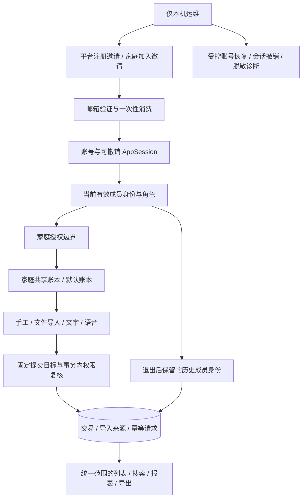

> 由 scope skill 于 2026-10-21 生成
> 状态：第一、二、三、四期已交付。第二期真实邮件收发由用户于 2026-10-21 确认验收通过；凭据消费及重放拒绝沿用既有自动化验证记录。第四期 v1.55.0 于 2026-10-22 正式发布，增量迁移、原账务及登录态保留、真实供应商和入口检查均通过；实际朋友邀请仍须有明确受邀对象。
> 第四期实施补充状态：已批准 2026-10-21；按本轮确认的 Excel 导出、本人分别选择 AI／语音及已受理任务继续完成的规则实施，既有前三期交付及邮件验收结论继续有效。

# 邀请制多家庭与共享多账本

## 目标

将现有两人自用账本扩展为由同一服务器承载的邀请制家庭记账服务，让朋友建立独立家庭、自助管理账号，与家人共同维护多个账本。升级必须完整承接现有正式服务数据，在维持快速记账、家庭整体复盘和成员归属的同时，通过服务端授权、数据约束及可重复验证的证据保障家庭之间的私密性。

## 决策基线

### 需求边界

#### 家庭、成员与角色

- 用户通过平台注册邀请创建自己的家庭；家庭负责人通过另一类家庭邀请让家人加入。两类邀请有明确用途，注册或接受邀请时展示目标，不能误把朋友加入现有家庭。首版采用邀请制，不开放无邀请注册。已有账号在退出或原家庭关闭后创建新家庭，也必须取得一份新的有效平台注册邀请；只复用本人账号，成功后创建新家庭、负责人身份和默认账本，不重新注册、重置密码或迁走原家庭数据。
- 一个账号同一时间只有一个有效家庭成员身份，可以一人起步并邀请多名家人；产品不固定为两人。成员离开后可以加入新家庭，原家庭数据不自动迁入新家庭。
- 家庭是权限和隔离边界，一个家庭可以有多个账本。家庭成员都能查看全部账本与家庭汇总；首版没有家庭内个人私密账本、账本独立成员表或只读角色。
- 角色沿用负责人 `OWNER` 与成员 `MEMBER`。两者都能记账、编辑、软删除和移动家庭记录，并保留必要的操作追溯。新建和重命名账本属于共同维护；家庭邀请、移除成员、负责人转让、默认账本管理、账本归档及家庭关闭限负责人。
- 每个有效家庭有一名有效负责人。负责人退出或停用账号前必须先转让；最后一名成员离开通过家庭关闭流程完成，不能留下仍开放但无人负责的家庭。家庭负责人不能设置或找回其他成员的密码，也不因此获得平台运维权限。

#### 账号与安全访问

- 提供邀请注册、邮箱验证、自助改密、邮件找回、会话查看与撤销，以及账号停用。普通改密验证当前密码；密码修改或恢复成功后撤销旧会话，用户重新登录。
- 新注册账号验证邮箱并完成邀请消费后才成为可用账号。存量账号保留原账号、密码和状态，可继续按既有方式登录；原邮箱未经实际验证不得标记为已验证。邮件找回仅向已验证邮箱发起；存量用户可验证当前邮箱，必要时验证当前密码后绑定并验证可用的新邮箱。
- 忘记密码、发送验证邮件及重发邮件的公开响应不暴露邮箱是否存在或其家庭归属。相关入口有限流、有限的凭据有效期和一次性消费语义；发信失败不能伪造已发送，也不能改变现有密码或让邀请错误消费。
- 家庭之间严格隔离；知道别人的家庭、账本、交易、草稿、成员、请求或导出标识仍不能读写或判断其中内容。平台维护者保留主机、数据库和备份管理能力，不承诺服务器维护者无法解密。平台管理界面和运维不新增跨家庭账目浏览、修改或代登录入口。

#### 多账本与既有记账

- 每个有效家庭始终有可用的默认账本。每条交易只属于一个账本；记错账本可以移动，保持交易身份、来源、成员归属及金额不变。账本是交易归集单位，不复制同一条记录形成多个账本副本。
- 手工、文件导入、文字和语音记账都明确目标账本；账本选择不能在异步任务执行期间被浏览器当前选择静默替换。记录、报表、搜索、分类偏好及钻取支持所选账本，并保留家庭整体查看。
- 归档账本保留历史、保持可查且仍计入家庭汇总，停止新增与修改；负责人可以恢复归档。归档默认账本前须先指定另一个有效账本，不能让家庭无有效默认账本。
- 同源导入去重保持整个家庭范围，包含软删除交易；把记录移动到其他账本不绕过去重。已有退款处理、导入分类和成员映射继续保持家庭范围，不因多账本重新建立互相隔离的映射副本。
- 导入仍经 `/records/import`，保留现有四种来源及已支持的压缩包形式；导入不创建分类。继续使用全局内置分类和家庭导入映射，首版不增加自定义分类体系。
- 金额使用整数分 `amountFen`，日期和范围按 `Asia/Shanghai`；中文默认、中英文切换、移动优先、快速连续记账及现有弱网幂等恢复行为继续有效。

#### 数据退出与开放保障

- 有效成员可以导出当前家庭的账目，按账本和时间范围选择。导出遵守与页面一致的授权，仅包含账务必要字段，不包含密码哈希、会话、恢复凭据、平台诊断或其他家庭数据。
- 退出、被移除或停用账号立即终止相应访问和待提交操作；历史记录保留原家庭与原成员归属。加入其他家庭不取得原家庭记录，也不把原记录迁入新家庭；经有效邀请重新加入原家庭后，新有效身份可以按家庭共享规则查看该家庭全部账本和历史。两种情形都不恢复旧会话、旧成员身份下的待提交任务、浏览器草稿或待确认结果权限。
- 负责人关闭家庭后撤销该家庭的有效访问与邀请，数据归档保留。普通成员不能关闭家庭。首版不提供自助永久删除；永久删除由单独核实账号本人或家庭负责人权限的受控流程处理，不能将个人停用等同于删除共同账目。
- 复用私有备份和恢复流程，补齐家庭级资源额度及必要管理审计。向朋友说明维护者的信任边界、归档保留方式，以及 AI、语音供应商会接收的数据；相关功能首次使用提供清楚说明和选择，手工记账始终可用。
- 不新增多人团队、收费套餐、公开社区、跨家庭共享账本、设备准入或硬件指纹等能力。

### 技术决策

#### 数据与授权职责

- 继续使用现有 Next.js、Auth.js、Prisma 与 PostgreSQL 17，共用应用和数据库，不为每个家庭复制服务或新建数据库。安全依赖每条家庭数据路径的服务端授权及关联约束，不以难猜 ID、前端隐藏或页面筛选代替鉴权。
- 将账号身份与可保留的家庭成员历史分开。成员退出标记失效，保留原 ID 和引用；再次加入建立新的成员身份，不将旧身份移动到另一家庭。数据库约束同一账号最多一个有效身份、有效家庭最多一名负责人；业务事务同时保证有效家庭至少有一名负责人。有效成员名在同家庭内保持唯一，历史身份允许重复显示名，不阻止同名重新加入；不能通过修改历史姓名、合并身份或复用旧 ID 绕过约束。
- 新增家庭关闭状态和账本实体。交易、导入草稿及需要绑定提交目标的自然语言请求保存账本归属；账本归属的家庭与记录、成员引用的家庭必须一致。用组合关联约束或等价数据库约束阻止跨家庭引用，不能只在单个表单校验。
- 当前成员授权与历史账目聚合使用不同的成员范围：操作权限只来自当前有效身份，家庭历史查询、成员筛选及金额／笔数聚合包含同家庭的历史身份，不能因成员退出、移除或停用将其交易排除。再次加入产生新身份，不改挂旧交易，也不按多个身份重复统计同一交易。
- `AppSession` 继续是受保护请求的服务端会话依据，校验账号可用、会话未过期且未撤销，并从当前有效成员身份派生家庭、成员和角色，再校验目标账本与操作。没有有效家庭的已登录账号只能进入创建／加入引导和本人账号操作，不能访问旧家庭账目。家庭共享账目不等于共享账号信息，成员列表不因此公开他人的邮箱验证状态、会话或恢复资料。
- 邀请消费、成员变更、负责人转让、关闭家庭及账务写入使用事务和必要的并发锁或等价约束。移除／退出与在途写入竞态必须具有明确先后结果；在失去权限后提交的任务不得成功写账。
- 新增最小操作追溯，只记录操作类型、操作者、目标标识、发生时间和必要状态变化；不把备注、财务正文、明文密码、令牌或恢复链接放入活动日志、审计摘要和诊断。运行请求也不新增 IP、MAC、硬件 ID 或浏览器指纹记录。

#### 邀请、邮件与账号恢复

- 平台注册邀请由现有本机受保护运维通道签发；家庭邀请由当前家庭负责人签发，邀请约束受邀邮箱、用途、目标家庭和允许角色，加入邀请只能产生普通成员身份。签发者失去资格、家庭关闭、撤销、过期或已使用的邀请不能继续生效。
- 邀请、邮箱验证和密码恢复采用独立用途的高熵随机凭据，持久化仅保存摘要及用途、主体、有效期、消费／撤销状态。浏览器不能决定家庭、角色、账号归属或邮件收件人；同一凭据不能跨用途使用。
- 新账号邮件验证成功时，在单个事务内消费邀请并建立账号、家庭成员及必要默认账本；并发验证仅一个成功，失败不留下半个有效家庭。已有账号须本人登录、账号可用、受邀邮箱已验证且没有其他有效家庭身份，才能消费新的平台注册邀请创建家庭，或消费家庭邀请加入目标家庭。前者复用原 `User` 并建立新家庭、负责人身份和默认账本，后者仅建立目标家庭成员身份；均在同一事务中复核账号资格、唯一有效身份和邀请状态。缺少新平台注册邀请、重用已消费邀请、仍有有效家庭身份或账号不可用时拒绝创建，不消费不应使用的邀请，不产生重复账号或孤立家庭。验证前的待完成注册有期限与有界重试，不无限占用邀请或数据库资源。
- 账号邮件经服务器配置的发信服务发送，供应商地址和凭据只在私有配置中。配置及真实发信能力是第二期开放前的部署验收项，不在仓库写入真实邮箱、生产入口或密钥。
- 验证／恢复链接只使用服务端可信的应用 HTTPS 根入口，不能由来访 `Host` 或客户端回调地址生成任意外部链接。处理页面避免凭据进入 referrer、第三方资源及日志；使用前后端与实际转发服务的证据核验泄露边界。
- 密码恢复只改变密码及相关凭据／会话，不修改账号封禁、家庭、角色或历史数据。家庭、账号状态变化及时撤销不再合法的会话、邀请与恢复操作；账号停用后的重新启用由受控流程核实，不利用找回密码绕过停用。

#### 多账本上下文与异步任务

- 家庭总览与单账本范围是可见的数据上下文，目标账本选择是服务端校验的请求输入；客户端选择只代表意图。家庭总览下记账使用明确展示的当前有效账本，无可用选择时使用默认账本并展示，不静默猜测其他账本。
- 导入草稿创建时固定目标账本；浏览器切换不修改已有草稿。确认时再次核验家庭成员及目标账本有效，账本已归档或权限已失效时拒绝写入并保留可解释的草稿状态。已完成草稿保留当时来源与目标，不因后续移动交易而重写历史来源。
- 每次手工或自然语言请求的 UUID 绑定原成员、家庭及目标账本。账本是请求内容的一部分，不通过把账本加入唯一键来允许同一 UUID 在另一本账本重复执行；相同 UUID 换目标必须返回原结果或冲突，不能产生第二批交易。
- 语音任务在开始处理时固定目标，转写后提交、模型返回及最终事务写账均复核授权。切换账本不将已提交任务重定向；任务结果显示原目标。退出／停用／移除取消未提交任务，迟到结果不能取得新的成员身份后继续写账。
- 浏览器草稿、选中账本、搜索令牌、待确认 UUID、请求缓存和分类偏好按适用的账号、家庭、成员及账本分域。旧格式兼容迁移只能落到原家庭默认账本；仅默认账本阶段允许旧写入格式兼容，多账本启用后缺少明确上下文的新写入提示刷新并选择目标，不能静默转入默认账本。原有效成员身份下查询旧已提交 UUID 不改变其业务终态或重新发送原文。失去原身份后清除可访问的客户端现场，重新加入也不能复活旧身份私有任务、结果查询权限或客户端现场；共享历史账目的可见性按新的当前有效家庭身份独立判定。
- 新增默认候选以有效成员为主；历史显示保留已退出成员标记，修改历史记录其他字段不能强制改变原成员归属。导入映射指向失效成员时要求重新确认，不能悄悄改记当前成员。
- 搜索、报表、列表、钻取及导出共享范围解析。有效查询继续过滤 `deletedAt: null`；同源去重与长期退款元数据查询按原规则保留软删除参与。记录移动只在同家庭有效账本间进行，保留记录 ID、原创建人、来源指纹、金额和发生时间。

#### 共享资源、运维与数据退出

- 保留现有全局登录／密码校验预算、文件大小限制、Agent 执行时限和音频租约上限，增加家庭与成员维度的有界并发／额度。额度取得和释放覆盖错误、取消、超时及进程边界；不能只依赖浏览器限制或无界内存队列。具体数值依据现有容量和负载证据设置，不引入套餐、计费或任意可调管理面板。
- 忙碌或额度不足返回可重试结果，不破坏已有草稿、幂等终态或手工记账。独立家庭不共用私有任务结果、模型上下文和缓存；保留现有 Agent 不直连账本库、音频私有临时目录与限时下载能力的边界。
- 平台运维仅增加必要的注册邀请管理，沿用现有受控账号恢复、会话撤销及脱敏运行诊断；不扩展到账本维护。OPS 仍仅本机 loopback 暴露，现有根路径 HTTPS、frpc、Docker Desktop 和私有 env 约束继续有效。
- 导出在生成与领取时确认有效权限，按需要流式或有界分批读取，私有临时产物有有效期与清理；不能通过公开静态目录或长期共享链接交付。表格格式需处理公式注入，金额和日期能按精确规则读回。
- 家庭关闭、成员退出及账号停用保留历史身份与财务数据。关闭操作需要负责人重新验证本人及明确确认影响，并在事务中结束该家庭有效成员关系、撤销访问和邀请。账号停用先满足负责人转让／关闭约束，再结束本人身份并撤销账号会话；其他家庭不受影响。
- 归档的家庭账目及长期导入元数据首版不自动清理。第四期交付永久删除申请指引和私有受控操作流程，涵盖账号本人／原家庭负责人身份核实、共同数据范围、备份保留限制、执行前明确确认及结果核验；个人请求不能清除共同家庭账目。本次实现不包含对真实数据执行永久删除的授权，每次实际删除按具体申请另行核实和授权，不通过删除账号级联清空家庭。

#### 现有正式数据迁移

- 这是现有正式服务的增量升级，必须迁移既有真实数据。保留所有原账号、家庭、成员、分类、交易及来源数据的身份；不通过 seed、重新导入、重置密码或重建默认用户替代迁移。
- 为每个已有家庭建立唯一默认账本。所有既有交易，包括软删除记录、待完成／已完成导入草稿，以及需要目标上下文的历史自然语言请求，回填到原家庭默认账本。导入行、退款关联、分类／成员映射和请求幂等关系保持完整；旧请求输入摘要与已完成结果不因新增账本字段被重写。
- 存量成员 ID、角色和用户状态保留，补充有效身份状态。迁移前检查缺失负责人、重复有效身份、跨家庭成员引用、孤立记录等异常；发现异常停止受影响迁移并报告，不能猜测归属、丢弃记录或强行通过约束。
- 采用新增结构、回填、核验、收紧约束的增量方式；大表回填使用批量／分块与明确事务边界，不能逐行查询写入。迁移可识别已完成步骤，重试不重复创建默认账本、不重复写账、不再次消费请求。生产通过经验证的迁移和现有 `prisma migrate deploy` 路径发布。
- 先在私有隔离环境恢复正式备份并演练迁移和验收。真实快照不进入仓库、普通开发／测试清库流程或外部 AI；自动化回归使用合成数据和独立开发／测试库。正式数据规模、实际约束和迁移耗时通过实施前的私有盘点与演练取得，不能把本轮代码阅读视为正式库核验。
- 正式切换采用维护窗口。停止接受新请求，等待或安全收敛在途导入、文字和语音任务，停下 web、OPS 及其他写入者；确认无写入后取得最终一致备份和校验摘要，再迁移。维护时长由演练估算，不承诺零停机。
- 备份须实际恢复成功，不能只通过归档目录可读或文件存在判断可恢复。保留旧镜像、私有配置、备份及受保护的数据副本；新增结构之外，原业务字段及其归属必须保持一致。
- 验收记录逐表行数、稳定排序的原字段摘要、按家庭／成员／月份／收支方向的金额与笔数，以及软删除、导入去重、退款关联和请求终态。预期新增账本及迁移记录单独核对；报告只含计数、摘要和结果，不输出真实账号、哈希、财务原文或入口。
- 恢复写入前，可按已演练方案恢复旧版本和一致备份。新版本已接受写入后默认向前修复；如必须回退，先停写并保全最新数据，验证兼容转换及完整性后再恢复服务。不能直接切回旧快照、删除新库或以丢弃新记录换取回退成功。
- 新版登录、历史查询及账务数据验收通过后才恢复正常写入；向朋友发放注册邀请须等待全部适用的开放门槛通过。

## 设计视图

### 功能设计

#### 首次使用与家庭管理

平台注册邀请到达后，新受邀者设置账号凭据、家庭名称并验证邮箱，完成后成为新家庭负责人，获得默认账本；已有账号从本人登录后的创建入口使用新的平台注册邀请，验证资格后复用原账号完成建家。家人从家庭邀请进入时明确展示目标，验证同一邮箱后直接加入，避免先创建不需要的个人家庭。无有效家庭的账号同时提供这两个入口，不以登录状态绕过邀请；已有有效家庭身份时禁止创建另一家庭或接受另一家庭邀请，引导先处理原家庭退出。

新增账号和家庭管理入口集中展示本人邮箱验证、密码、会话、成员角色、邀请状态与退出操作，不把家庭管理塞进每次记账流程。负责人操作展示影响并确认，失败保留当前状态；邀请过期、邮箱不匹配、同时消费和负责人已变更均返回可理解结果，不泄露其他家庭信息。手机优先布局，所有新增文案同步中英文。

#### 日常记账与复盘

应用保留当前默认记账路径，在导航和记账入口展示当前账本，提供家庭总览和账本切换。用户选择上下文后，记录、报表、搜索和钻取携带同一范围；从家庭总览开始录音或填写时也能看到实际写入目标。成员筛选使用真实家庭成员及历史标记，不硬编码配偶或只有两个人。

记录编辑支持同家庭账本移动；编辑或删除仍沿用软删除和成员归属规则。归档账本的历史可查且纳入家庭总览，归档不改变家庭收入支出合计。导入页在上传与确认阶段展示固定目标和家庭范围去重结果；移动过的来源记录依然能识别为已导入，完成草稿及退款元数据作为长期来源证据保留。

文字与语音保持现有直接记账、后台处理和原 UUID 确认。任务列表或结果提示显示原目标账本；用户转去另一本账本不会改写任务，失去权限后不继续提交。账号、成员身份和家庭改变时，旧草稿与待确认状态不会出现在新家庭。

#### 导出、离开与关闭

成员可按当前家庭、账本及时间范围导出可见账目。离开前明确说明本人将失去家庭访问，但历史账目继续保留，其他有效成员的历史汇总和历史成员筛选不受影响；负责人须先转让，或在关闭家庭流程中确认全部影响。经邀请重新加入同一家庭后，可以再次查看家庭共享历史，但旧身份会话和任务不会恢复；转入另一家庭时仅访问新家庭数据。停用账号结束本人登录，关闭家庭结束全体成员的该家庭访问，二者都不自动永久删除共同历史。平台受控处理永久删除的说明与入口指引清楚，不提供首版自助清库按钮。

### 技术设计

#### 整体方案

认证层负责账号和当前身份；家庭授权层负责角色、家庭状态和账本归属；业务服务只接收已校验上下文，事务内再次检查可变权限。数据层约束关联的一致家庭，统一范围解析供所有读写、导出与异步入口复用。共享基础分类不携带私有家庭数据；私有请求、缓存与文件必须有明确作用域。

#### 关键结构

| 结构 | 职责及约束 |
| --- | --- |
| `User` | 独立账号、密码和可用状态，增加邮箱验证与停用所需状态；不再假设永久只存在一条成员记录 |
| `Household` | 家庭状态、成员与负责人不变量，关闭后禁止普通账务访问 |
| `HouseholdMember` | 保存每次加入的身份、角色及失效时间；保留历史引用，同一账号最多一个有效身份；有效成员名与历史同名分别处理 |
| `Ledger` | 家庭内账本、归档状态和默认关系；只有同家庭且有效的目标可以写入 |
| 邀请及验证／恢复凭据 | 独立用途、邮箱和家庭绑定、摘要存储、有限期限、一次性消费／撤销；待注册数据有界 |
| `Transaction` | 增加账本归属，保留原主键、来源及成员引用；移动不复制，不改变原创建人 |
| `ImportDraft` / `ImportDraftRow` | 草稿绑定账本，明细和退款关联保留长期来源；去重和映射保持家庭范围 |
| `NaturalLanguageRequest` | 固定原成员和账本，保留原 UUID 唯一性、租约和终态；不按新账本重新执行旧请求 |
| 会话、追溯与额度 | 会话与实际有效身份核验；追溯最小化；共享资源同时有全局和家庭／成员边界 |

具体字段名、索引布局、受保护页面路径与邮件适配器实现由 implement 按现有模式细化，不改变上述归属、状态和安全不变量，不另建通用权限平台。

#### 实现流程

1. **进入服务**：校验邀请用途及邮箱，新账号完成验证后原子注册并建立或加入家庭；已有无家庭账号登录后消费新平台注册邀请创建家庭，或消费家庭邀请加入，不重复建立账号。登录建立 `AppSession`，受保护入口从数据库取得当前有效身份及角色，无家庭者进入受邀请约束的引导。
2. **读取与记账**：统一解析家庭总览／单账本意图，验证目标归属；写请求固定目标和 UUID，获取有界处理额度，外部处理后在短事务中复核身份和账本，再提交账务、终态与最小追溯。
3. **处理家庭变化**：并发保护负责人和成员不变量，结束身份或关闭家庭，撤销访问与无效邀请；在途任务以同一授权边界拒绝晚到写入，历史身份与来源数据保持可追溯。
4. **升级存量服务**：盘点并恢复演练正式快照，增量建立默认账本及新约束，核对原字段与统计，维护窗口内执行最终迁移；校验失败保持停写并按数据保全规则恢复，不继续开放注册。

### 分期交付与依赖

这是用户已确认的交付顺序，各期形成可独立验收的成果；详细实现任务由 implement 规划。每期提交、推送及发布遵守 `AGENTS.md` 与 Git 偏好，代码变更执行完整验证与安全审查，不以阶段名称跳过门槛。

| 阶段 | 交付边界 | 开放条件 |
| --- | --- | --- |
| 第一期：隔离与正式数据迁移 | 家庭／历史成员／账本模型、有效身份与统一授权、迁移及回退证据；全部现有读写、导入确认、文字／语音写入及旧 UUID 恢复立即贯通默认账本，必要兼容不能推迟到第三期 | 私有迁移演练和正式停写迁移均验收；原账号、历史账目及全部既有入口正确，先不发放朋友注册邀请 |
| 第二期：账号与家庭自助 | 平台／家庭邀请、已有无家庭账号受邀创建／加入、真实邮件、验证与改密找回、会话管理、成员退出／移除及负责人转让；默认账本可用 | 双家庭授权、邀请竞态、邮件、失效会话及成员变化前后历史汇总不变等验收通过 |
| 第三期：完整多账本流程 | 在第一期全部默认账本入口可用的基础上，增加用户可选多账本及新建／重命名／切换／归档、移动记录；列表、搜索、报表、导入、文字、语音和恢复支持明确目标 | 家庭与账本上下文、在途切换、幂等、家庭去重及汇总一致 |
| 第四期：开放保障与朋友试用 | 导出、账号停用／家庭关闭、永久删除申请指引与私有受控流程、家庭级额度、隐私说明、恢复与真实入口检查，小范围邀请试用 | 完整回归、安全审查、实际备份恢复、发信及供应商／转发边界和容量检查通过后开放 |

#### 第一期登录态兼容

- 正式迁移保留仍有效的登录态，将既有 `AppSession` 绑定原家庭成员身份；保留原有效期及撤销状态，不恢复失效会话。无法唯一核对原身份时停止迁移并报告。
- 旧 JWT 兼容只能对应原家庭、原成员；成员身份结束后，旧会话、旧 token 和旧任务不能随账号加入其他家庭或重新加入原家庭而取得新权限。
- 原身份仍有效时，旧客户端草稿及待确认 UUID 可以安全恢复；已完成请求返回原结果，新增账本上下文不重新执行旧请求、不修改原输入摘要与业务终态。
- 迁移前已登录的浏览器在切换后刷新仍可正常使用；同一 UUID 继续只产生原有交易。身份结束及重新加入的合成场景须验证旧会话与旧任务仍然失效。

#### 第二期实施补充

- 使用 163 SMTP 提供真实发信；服务端通过私有配置读取发件身份、授权码与可信 HTTPS 根入口。跟踪文件只保存占位符，不保存真实邮箱、授权码或入口。
- 账号自助页面独立于家庭账务布局，无有效家庭的本人仍能验证／换绑邮箱、修改密码、管理会话和接受新邀请。普通成员看不到他人的账号验证、会话和恢复资料。
- 邮件链接将凭据放在 fragment，客户端读取到内存后立即清除地址栏；凭据不进入请求 URL、回调地址、浏览器持久化存储或第三方资源，只有明确提交才消费。打开邮件的自动扫描不能完成注册或恢复。
- 邀请先明确用途与目标。新账号提交待完成资料后验证邮箱，再原子建立账号与身份；已有账号在邀请页面本人登录后确认。创建／加入成功撤销旧会话并重新登录，旧账号级会话不静默升级为新身份。
- 邀请有效期七天，注册验证有效期三十分钟；同邀请待注册尝试及发信、验证、密码计算均有服务端共享预算和限流。失败发信不消费邀请、不改变密码，公开响应只说明条件受理，不伪称已发送。
- 负责人转让后撤销其未使用的家庭邀请。退出／移除保留历史身份和账目，并使旧会话与相关待完成凭据失效；最后负责人退出须等待第四期家庭关闭流程，第二期明确阻止。
- 延续原正式数据增量升级约束，新增邮箱验证时间默认空，不重建账号、重置密码、执行生产 seed 或更改原家庭账务。

#### 第三期实施补充

- 本设备首次进入显示家庭总览，之后按当前有效成员身份记住上次查看范围。明确链接中的范围优先；其他账号、家庭或重新加入形成的新成员身份不能继承旧身份偏好。
- 单账本视图开始新记账时预选该有效账本。家庭总览记住上次使用的有效记账账本，首次或原选择已不可用时展示家庭默认账本；提交前始终显示实际目标。查看范围与新记账目标分别表达，浏览器偏好仅代表意图，服务端校验实际归属与状态。
- 账本管理支持新建、重命名、默认设置、归档及恢复；共同维护与负责人权限沿用原基线。归档账本可以单独查看历史但不可修改，家庭总览继续包含其历史；默认变更、归档与写账使用家庭优先的同一并发边界。
- 所有列表、搜索、金额筛选、首页报表、分析和钻取共享家庭总览／单账本范围。家庭总览编辑记录时使用该记录原账本；移动只支持同家庭未归档账本之间的单条记录，保留来源、金额、发生时间和原成员归属。
- 客户端按账号／家庭／成员管理身份生命周期，按账本保留草稿及每个任务的固定目标。同一身份切换账本不清除其他账本草稿、在途任务或待确认 UUID；任务提示显示原目标。身份失效仍结束原私有任务访问，不能借重新加入恢复。
- 本期增量迁移为部署时已有默认账本保存不可随默认切换改变的旧草稿兼容标记。旧格式只能迁入该标记账本；新建家庭或无标记者不猜测旧目标，不用账本创建顺序推断归属。
- 导入上传明确选择目标，草稿创建后不支持静默改换目标；确认失败保留可解释状态。来源去重、分类和成员映射及退款长期元数据继续保持家庭范围。
- 多账本阶段的新写入必须携带明确上下文，旧页面缺少上下文时提示刷新选择，不静默写默认账本。原合法身份仍能确认旧已提交 UUID，包含已归档目标上的成功结果；移动、切换或更换默认不能使同一 UUID 重做。
- 不新增自定义分类、账本私有权限、批量移动、导出、账号停用或家庭关闭；不借本期开放真实朋友试用。沿用既有四期顺序与已确认的 Wiki 目标。

#### 第四期实施补充

##### 决策基线

- 导出格式为 Excel `.xlsx`。有效成员可选家庭总览或单账本及时间范围，包含所选范围内归档账本和历史成员的有效交易，排除软删除交易；沿用共同账务可见性，不增加个人私有导出权限。金额可无损读回整数分 `amountFen`，日期明确使用 `Asia/Shanghai`；不将备注等文本解释成公式或外部链接。
- 补齐本人账号停用及负责人关闭家庭，沿用重新验证当前密码、明确确认影响和家庭优先事务锁。先满足既有负责人转让／关闭约束，再结束相关有效身份、撤销会话与无效邀请／恢复凭据；不留下开放但无负责人的家庭。关闭家庭不等于停用其他成员账号，两种操作均保留历史身份、交易、来源和长期导入元数据。账号重新启用沿用本人核实的受控流程，不借密码找回恢复停用状态或旧身份。
- 交付永久删除申请指引及私有受控操作流程，落实本人／原负责人核实、个人与共同数据范围、备份保留限制、每次执行前明确授权和结果核验。停用、关闭和本期验收不授权删除真实共同账目，也不扩展 OPS 到账号删除、账务维护或代登录。
- AI 处理和语音识别由每个账号本人分别选择，服务端持久保存并跨设备生效，在账号页可关闭；未明确同意的能力不能接收新任务，存量使用记录不视为同意。AI 选择覆盖文字记账和导入智能推荐，语音记账须同时开启 AI 与语音；家庭负责人不能替其他成员选择。手工记账、手工分类映射、历史查看与已提交结果确认继续可用。
- 关闭能力选择后，只拒绝新任务，关闭前已由服务端受理的任务可继续完成并可能入账。语音的一次受理覆盖本次录音的转写、AI 解析和账务提交；仅浏览器排队、尚未受理的工作按新任务处理，导入推荐尚未提交的后续批次也按新任务处理。额度不足或未通过校验的请求不算已受理；客户端时间、旧开关状态和自行生成的 UUID 不能证明曾受理。
- 已受理任务继续绑定原账号、家庭、成员、目标账本、本次输入和有限执行时限，不能凭旧许可发送新正文、追加任务或无限重试。能力开关关闭只改变新任务准入；会话撤销、退出、移除、账号停用、家庭关闭或目标账本归档仍按现有规则阻止不合法的后续处理／写入。已完成 UUID 只查询原结果，不再次外发或入账；开关变化不重写终态，也不删除已完成账目。
- 保留现有全局处理、文件、音频和执行时限上限，增加数据库共享的家庭／成员额度与限时占用，覆盖导入、AI、语音及有界导出处理。切换账本、重登、跨进程请求和原 UUID 查询不能增加处理名额或重复扣减额度。具体数值、窗口和释放上界按代表性容量验证固化，不增加套餐、收费或任意额度管理面板；繁忙时返回可理解的可重试结果，不自动重发正文、改换 UUID 或破坏草稿及终态。
- 隐私说明覆盖维护者可接触的服务端数据、归档保留与备份限制、当前启用的模型／语音供应商及后备处理、各功能发送的数据和音频临时保留边界。首次相关功能使用前清楚展示并让本人选择；关闭开关不能撤回已发送给供应商的数据，应用侧清理不代表供应商侧删除。试用开放沿用完整回归、安全审查、实际恢复、真实入口及供应商／转发边界和容量门槛；实际邀请须有明确受邀对象，不能从示例邮箱或历史资料猜测收件人。

##### 功能设计

导出入口沿用当前家庭总览／单账本查看范围，并允许明确选择时间范围；提交前展示范围，生成后通过受保护下载领取 `.xlsx`。只输出可见账目的必要字段，包括账本、原成员归属、收支方向、分类、金额、上海发生时间、备注及必要来源说明，不包含账号邮箱、来源指纹、原始导入行、凭据或运维诊断。生成／下载失败保留所选范围，提供重试提示；退出或关闭后不能领取旧产物。

账号页集中展示 AI、语音的本人选择和停用入口，家庭管理页向负责人提供关闭入口；无有效家庭的本人仍可管理账号选择及办理停用。首次使用文字记账、智能推荐或语音时，先说明本功能的数据去向并完成所需选择，再由用户明确发起任务；拒绝后保留手工路径和当前可用草稿，不自动上传。关闭开关时说明已受理任务会继续完成，任务仍显示原目标及可确认的结果；在其他设备关闭后，当前页面的旧显示不能绕过服务端新任务准入。

停用和关闭页面分别说明影响对象、访问失效、历史保留与导出入口，使用当前密码及明确确认提交。失败保持原状态，不隐式关闭家庭或清空账目；成功后结束失效的客户端现场并进入合法的登录／无家庭引导。永久删除通过说明中的私有维护通道申请，只提供核实和执行规则，不生成公开清库入口或以真实删除进行演练。

##### 技术设计

本人能力选择是账号状态，不承载家庭账务权限；使用本人有效 `AppSession` 读取／修改，并保留最小变更审计。新任务准入在服务端并发边界内核验当前选择、身份、目标和可用额度，记录可验证的受理事实，再开始外部处理；与关闭开关竞争时按这一顺序确定新旧任务，不按客户端声明判断。

受理事实与原任务标识、上下文、所需能力和有限期限绑定，延续已有 UUID 幂等与租约，不创建第二套账务提交路径。语音两阶段之间使用本次受理的有限延续依据，绑定本次音频及转写输出，不能把旧依据用于任意文字输入；后备调用只能处理同一次已受理输入。正文及音频继续只用于本次内存／私有临时处理，不为支持跨阶段许可新增持久化正文、音频或浏览器副本。关闭开关后，合法的原任务仍须在各阶段及最终短事务中复核原会话、成员、家庭和账本；查询终态不需要重新同意处理，也不重新调用供应商。

资源占用使用跨进程一致的额度记录和有期限的租约；正常结束、异常、取消、超时主动释放，崩溃后可在有界期限回收。工作仍在运行时不能提前释放以突破现有全局上限，迟到工作不能借已失效租约提交；重试及查原结果不生成第二个原任务。拒绝新任务不影响其他家庭的基本读写和手工记账，代表性负载同时核验数据库、解析进程、Agent 与音频临时存储边界。

导出复用页面的家庭／账本范围授权与有效交易过滤，按稳定顺序有界分批取得一致范围的账目，并以安全单元格类型写出，避免全量无界载入。生成和领取均复核当前访问权限；确需中间文件时存于非公开的私有临时位置，设置有效期、大小／并发边界和清理，不使用公开静态目录或长期共享链接。下载不缓存，不把财务明细或领取能力写入 URL 日志、浏览器持久化存储及诊断。

生命周期变更与在途写入沿用同一锁序和最终授权事务，保留历史引用及家庭统计。新增字段、受理／额度结构和必要审计采用增量迁移，沿用私有备份恢复、原字段摘要及统计核验，不改写已发布迁移或执行生产 seed。说明和私有运行证据分开保存，跟踪文件只使用占位符；邮件收发复用已有用户验收证据，只有相关配置或边界变化使其失效时补验，不重新打开已关闭的邮件验收项。

##### 本期文档落地

实施时更新 `docs/wiki/households-and-ledgers.md` 的导出、生命周期和额度约定，更新 `docs/wiki/natural-language-accounting.md` 的本人选择及在途任务规则，更新 `docs/wiki/import-category-agent.md` 的智能推荐准入与额度边界。沿用 `README.md`、恢复和实际入口检查 runbook 补齐使用说明及开放证据；Wiki 保存稳定约定，私有核实材料、受控操作步骤中的真实值及运行证据不进入跟踪文件。

### 预估改动面

- `prisma/schema.prisma`、新增迁移及私有运行的迁移／核验工具：成员历史、账本、邀请、账号验证／状态、关联约束及完整存量数据承接；不改写已发布 migration。
- `src/auth.ts`、`src/auth.config.ts`、`src/lib/auth/*`、认证路由及新增账号／家庭服务与页面：无家庭登录态、当前身份、角色、邀请和邮件恢复、会话撤销。
- `src/components/app-shell.tsx`、导航、记账／编辑／筛选／报表组件、`src/app/(app)/*`、`src/lib/i18n.ts`：必要账号／家庭管理入口、多账本上下文与历史成员展示；沿用现有移动端风格，不顺手重做页面。
- `src/lib/transactions/*`、`src/lib/records/*`、`src/lib/reports/*`、`src/lib/imports/*` 及对应 actions/routes：统一范围、来源去重、移动、历史兼容与数据导出。
- `src/lib/voice/*`、文字和语音提供者、`src/app/api/voice/*`、浏览器草稿／UUID 恢复：固定账本、身份变化、租约与原请求兼容，不新增另一条账务提交机制。
- `src/lib/ops/*`、`src/app/ops/*`、诊断及活动追溯：最小邀请管理、当前身份兼容与脱敏边界；不开放账本维护。
- `.env.example`、`compose.yml`、适用部署脚本、`README.md`、`docs/runbooks/restore.md`、`docs/runbooks/home-network-checklist.md` 及必要迁移 runbook：私有发信配置透传、维护窗口、备份恢复和实际入口验收，不改变现有生产网络拓扑。调整 bootstrap 时保留已有默认账号的示例约束，正式迁移不执行 seed。
- `AGENTS.md` 与 `skills/billboard-security-review/SKILL.md`：在实现阶段同步已确认的多成员／多家庭、多账本和邀请运维边界；保留整数金额、时区、隐私及正式发布门槛，不能用修改规则消除失败。
- `tests/unit`、`tests/integration`、`tests/e2e`：真实授权边界与双家庭 fixtures、邀请／身份并发、迁移及既有流程回归；自动化测试仅连接开发／测试库。
- 前三期 Wiki 目标已落地：已建立 `docs/wiki/households-and-ledgers.md` 并更新 `docs/wiki/wiki.md`，保存稳定的家庭、成员、账本、权限和数据归属约定；第四期 Wiki 更新范围见“本期文档落地”，不把一次性实施 checklist 写进 Wiki。
- 第四期在现有账号／家庭页面与服务、受保护导出入口、自然语言／导入／语音准入、Prisma 增量结构和共享资源处理处细化；覆盖 Excel 安全序列化、本人选择跨设备并发、两阶段受理延续、生命周期、额度释放及开放检查。

## 验收

### 正式数据迁移与兼容

- 私有正式快照盘点、备份和恢复演练 → 原有全部应用表及迁移历史可恢复，演练环境与正式库隔离；归档校验、实际恢复记录及环境核对证据。
- 对含软删除、完整导入与退款关联、旧 UUID 结果的存量数据迁移 → 每个原家庭恰有默认账本，原账号、成员、交易和来源 ID 不变，原业务字段摘要、按家庭／成员／月份／类型的金额及笔数一致；迁移 fixture 集成和私有演练统计。
- 同一回填／发布流程重试，或遇到异常旧关联 → 已完成数据不重复生成，异常不被丢弃或猜测修补；幂等迁移与约束失败用例、演练重试证据。
- 原账号登录、历史查询、移动记录后重新导入及退款复核 → 原密码与账号状态有效，存量邮箱未被虚假验证，旧来源仍去重且退款不重复抵扣；合成存量集成／e2e、正式迁移后的最小只读或受控 smoke。
- 维护窗口中仍有写入者或未知在途结果 → 不取得虚假的一致快照，不继续迁移／开放；停写核验、任务终态检查及维护演练。
- 切换失败或新版已接受写入后恢复 → 按实际阶段恢复并保全最新数据，不以旧快照覆盖新账；回退／向前修复演练及恢复后的全量一致性证据。

### 账号、邀请与家庭生命周期

- 平台邀请与家庭邀请首次使用 → 前者创建独立家庭与负责人及默认账本，后者加入明确家庭成为普通成员，不多建无用家庭；数据库集成和完整首次使用 e2e。
- 已有账号退出家庭或原家庭关闭后，使用新的有效平台注册邀请创建家庭 → 复用原账号、密码和状态，只创建新家庭、负责人身份和默认账本，原家庭数据不迁入；缺少新邀请、旧邀请重用、邮箱不匹配／未验证、账号不可用或仍有有效家庭身份时拒绝创建，无额外账号或孤立家庭；邀请资格、并发创建／加入集成及登录后建家 e2e。
- 伪造角色／家庭／邮箱、过期／撤销／已消费邀请、并发验证 → 拒绝越权且至多一次消费，无半个有效家庭或额外有效身份；真实约束／事务并发集成。
- 邮件发送失败、重发、验证／恢复凭据过期或重放 → 给出可理解结果，不消费错误邀请、不改变旧密码、不泄露账号存在性；邮件 HTTP／SMTP 边界 fixture、限流与重放测试。
- 新注册、存量验证／换绑邮箱、正常改密与忘记密码 → 收件人经服务端绑定并验证，凭据不进入日志或第三方资源，原密码仅在成功后失效，旧会话与旧恢复凭据不能继续使用；认证集成／e2e及合成账号真实发信 smoke。
- 成员被移除／退出、负责人并发转让、停用账号或关闭家庭 → 角色和唯一有效身份不变量保持，旧会话、邀请和待提交任务不能越权，历史归属不变，其他家庭不受影响；并发集成与双会话 e2e。
- 原账号加入其他家庭 → 使用新的成员身份，只能访问当前家庭共享历史，不能查询原家庭记录、原身份 UUID 结果或恢复旧客户端现场，原记录及创建者保持原家庭；跨家庭授权、成员历史、浏览器状态及数据查询回归。
- 原账号以原昵称经邀请重新加入原家庭 → 使用新的成员身份，有效昵称约束不被历史同名阻塞，全部家庭共享历史可查，原交易仍归旧身份且不重复计入；旧会话、旧身份 UUID 查询、待提交任务和客户端现场仍失效；同家庭重新加入、历史归属、会话／异步隔离集成及 e2e。
- 成员退出、被移除或停用前后，剩余有效成员查询相同时间和账本范围 → 家庭收入／支出总额、笔数、分类汇总及历史成员筛选结果保持一致；重新加入产生新成员 ID 后也不漏算或重复计入旧身份交易；含有效／历史多身份的首页与分析报表、列表和成员筛选集成及生命周期 e2e。

### 跨家庭与多账本

- 至少两个家庭、多个成员、多个账本直接请求交易／草稿／映射／搜索／报表／导出／UUID／语音结果 → 所有读写按实际身份授权，非法目标不泄露其内容或存在性；覆盖实际服务端入口与部署数据库连接身份的授权矩阵，不能仅测试隐藏按钮。
- 同家庭非本人创建的记录编辑、删除或移动 → 普通成员按共同维护规则操作成功，原创建者与来源不变，有必要操作追溯；角色矩阵集成及记录 e2e。
- 新建、重命名、设置默认、归档／恢复账本 → 普通共同维护与负责人专属操作边界正确，不能无有效默认账本，归档历史仍纳入家庭总额且不可写；角色、状态约束及汇总集成／e2e。
- 账本切换、家庭总览钻取、搜索／金额筛选／分类偏好／导出 → 范围一致，不出现其他账本误计或其他家庭数据，归档不使历史家庭金额消失；查询集成及导航 e2e。
- 同一来源流水跨账本导入、记录移动或软删除后再次导入 → 家庭去重继续有效，映射家庭共享，退款关联及长期草稿保持完整；四来源及退款回归。
- 语音／文字／导入提交后切换账本、归档目标或撤销成员权限 → 不重定向、不重复入账，失效目标拒绝，原 UUID 可在原合法上下文确认；并发事务、弱网及异步 e2e。
- 手工／自然语言相同 UUID 换目标，旧协议结果与旧浏览器存储恢复 → 返回原结果或明确冲突，不能跨账本重做；幂等集成、旧格式 fixture 和刷新恢复 e2e。

### 开放保障与交付

- 成员导出、退出、账号停用与负责人关闭家庭 → 导出只含授权账务字段，公式内容安全、金额和上海日期精确；状态变化立即失效访问且不自动删共同历史；导出解析、授权及生命周期集成／e2e。
- 家庭总览／单账本、时间边界、归档账本与历史成员的 `.xlsx` 导出 → 内容与相同范围的有效账目一致，无软删除或其他家庭数据，整数分和上海时间可精确读回，恶意文本不产生公式／外部链接；Excel 解析、范围与字段白名单测试及下载 e2e，覆盖生成后权限失效、过期清理和代表性大导出边界。
- 本人首次选择、跨设备修改、无家庭账号及存量未选择账号 → 两项选择分别保存，AI 覆盖文字／推荐，语音记账须两项开启；旧页面或直接请求不能绕过新任务准入，普通家庭成员看不到他人的选择，拒绝后仍能手工记账及手工映射；本人状态、服务端入口矩阵、并发集成及中英文 e2e。
- 关闭能力与文字／语音／推荐受理并发 → 服务端受理前的新任务拒绝，已受理的同一任务可在原期限内完成；语音转写后的原输入可继续 AI 入账，浏览器排队及后续推荐批次不冒充旧任务，旧依据换正文／目标／身份或超时复用均拒绝；受理竞争、两阶段延续、防重放及跨设备 e2e。
- 已受理任务期间撤销会话、退出／移除／停用、关闭家庭或归档目标 → 能力关闭的继续完成规则不提升业务权限，不合法的晚到结果不能写入；已完成 UUID 仍按原合法身份返回终态且不重复外发或写账；生命周期并发集成、异步 e2e 及原 UUID 恢复回归。
- 永久删除申请与受控处理说明 → 本人／原负责人核实、共同数据范围、备份保留和逐次执行授权均明确，不能把账号停用或家庭关闭当作清库授权；申请指引和私有 runbook 的针对性审阅，不执行真实删除来验收本次功能。
- 一个家庭集中导入／调用 AI 或语音，含取消、超时、进程重启 → 额度和租约有界且正确释放，已有幂等请求不被额度重试复制，其他家庭的基础操作仍可完成；代表性并发／负载及跨进程边界证据。
- 实际发信、模型与语音服务、HTTPS 转发、OPS 和私有备份 → 合成输入可用，凭据和能力链接不进入外部日志，OPS 保持本机，备份可恢复；实际部署配置核验及合成 smoke，不能用静态示例或健康页代替。
- 中文与英文、多人家庭、手机记账及既有手工／导入／文字／语音流程 → 文案完整、快速记录和弱网恢复保持可用，无新增无关页面和团队能力；针对性 UI 检查及完整回归。
- 各期代码／运行配置交付 → `npm run lint`、`npm run test:unit`、`npm run test:integration`、`npm run test:e2e` 全通过，完成实际变更面的安全审查；仅文档阶段执行针对性文本与版本检查，安全结果包含 Findings、Verification、Residual Risk。
- 首次正式迁移及后续发布 → 已验证的本任务提交合入并推送 `master`、远端 SHA 核对成功，发布输入对应该提交，按现有脚本迁移与启动后 smoke 通过；Git／构建输入及健康证据。失败不得宣称已上线，也不得提前发出朋友注册邀请。
