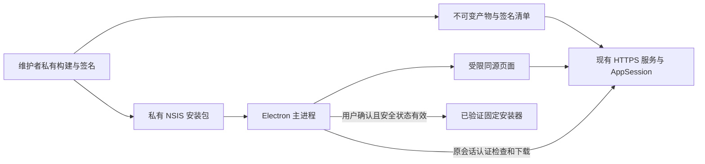

> 由 scope skill 于 2026-10-23 生成
> 状态：已批准 2026-10-23

# Windows 联网桌面客户端与应用内更新

## 目标

将现有 BillBoard 封装为可安装、可从桌面打开并在应用内升级的 Windows 客户端。电脑与手机、网页共用原账号和家庭账目，使用者不需要安装开发环境或数据库；继续服务快速记账、家庭查看和按时间复盘。

## 决策基线

### 需求边界

- 首版交付 Windows x64 安装版 `.exe`，以当前 Windows 11 x64 电脑作为交付及主要验收环境；其他系统版本的兼容性只按实际证据记录，不宣称已经实机通过。首版不交付免安装版、32 位、ARM64、macOS 或 Linux 客户端。
- 客户端联网访问现有 HTTPS 根路径服务，复用现有 PC 页面、账号密码及服务端 `AppSession`。账目和业务处理继续由现有服务负责，不部署本机数据库，不新增离线记账、同步机制或本机后台服务。
- 保留现有登录、手工及自然语言记账、语音、账本与成员范围、记录编辑、账单导入、Excel 导出、账号管理和家庭可选加密功能。金额、上海时区、身份授权、原 UUID、本人 AI／语音选择和资源政策沿用仓库规则。
- 使用当前 Windows 用户级安装，提供桌面和开始菜单入口及系统卸载入口。应用使用固定产品标识和用户数据目录；覆盖升级保留登录资料、受保护家庭码、已持久化的草稿及待确认状态，普通卸载保留本机应用资料；不延长会话、不恢复已撤销授权，也不保证尚未持久化的内容跨进程恢复。
- 本机材料由应用独立保存，与已有浏览器及 Android 的登录资料分开。显式退出、切换身份和成员失效沿用既有清理边界；同身份会话到期可保留既有规则允许的受保护材料，重登录先查原 UUID，不自动重发输入。
- 更新采用应用内检查、下载及用户确认安装。仅网页版本变化不提示桌面容器更新；提醒以实际已安装客户端版本为准。取消、断网、鉴权失败、签名失败、下载失败或后台下载完成均不得擅自退出或安装。
- 安装前要求用户保存未提交内容，并确认录音、待确认记账、编辑保存、导入导出及家庭加密转换／换钥等关键操作均已收敛。未知忙碌状态禁止安装；安装须关闭当前进程，不能承诺正在运行的任务不中断升级。
- 安装包与更新产物仅私下分发。首版使用独立维护的更新签名密钥，不采购 Windows 发布者证书；Windows 可能显示发布者未知或相关安装提示，不要求用户关闭系统防护。初次安装包及内置公钥通过可信私有渠道交付，更新签名不替代 Windows 受信发布者身份。
- 默认中文并保留英文切换；网页新增文案写入 `src/lib/i18n.ts`，本机加载、权限、更新与错误提示提供对应中英文，按应用所选语言展示。

### 技术决策

- 使用 Electron 封装现有站点，以 electron-builder 的 NSIS 目标生成完整安装包，随包携带运行内核。锁定已发布且受支持的依赖版本，不依赖未发布文档中的 API；包体积接受随内核增大，不引入其他桌面框架或远程安装引导器。
- 主进程负责窗口、持久会话、导航与权限策略、文件保存和更新状态机；受限渲染进程负责现有网页。启用沙箱、上下文隔离及 Web 安全，禁用网页 Node.js 集成、任意原生接口、远程调试和不可信窗口创建；TLS 错误不允许跳过。
- 家庭码首先复用现有 IndexedDB／Web Crypto 保护方式和身份清理流程，不额外新增 Windows 持钥桥。产品标识、会话分区及数据目录跨升级保持稳定，普通关闭和启动不全量清理存储；主进程不读取财务草稿或家庭码用于更新。
- 服务地址从 Git 外私有构建配置注入，限定为既有 HTTPS 根 origin，不接受客户端页面指定服务地址、下载 URL、文件路径或执行参数。浏览器页面只可通过可信主框架的窄桥调用固定更新动作；Cookie 和其他原生能力不交给页面。
- 更新真实性使用 Ed25519 签名，客户端内置单个持久公钥，私钥仅存在维护者私有存储及本次构建／发布进程。签名绑定产品、平台、架构、三段版本、文件大小、SHA-256 和中英文说明；签名校验与摘要校验均须通过，不退回仅 HTTPS 或仅摘要校验。
- 使用固定同源认证接口提供更新清单和不可变安装包。更新任务固定原有效会话；退出、撤销或身份失效后不能借后来的登录继续安装。主进程仅在原任务内使用 Cookie，不将其写入清单、命令行、日志、网页或对外重定向。
- 不依赖现有 Android APK 更新协议中的 `versionCode`、`minSdk`、签名或安装器；Windows 使用独立协议和产物目录。网页只做本次必要的状态／界面复用，保留 Android 更新行为与普通浏览器兼容。
- 服务端不新增财务数据模型或迁移，不改变现有账号、会话、数据库、公网端口和转发链路。更新产物以私有目录只读挂载到服务容器；服务不持有更新签名私钥。

## 设计视图

### 功能设计

#### 安装与日常使用

安装后由桌面或开始菜单打开“BillBoard”，进入独立窗口，支持正常窗口缩放和现有桌面布局。重复启动聚焦已有窗口，关闭窗口退出客户端，不新增托盘或开机自启。首次使用自行登录；后续启动及覆盖升级从固定用户数据目录恢复资料，再由服务端判断会话和身份是否仍有效。

首屏提供加载状态。断网、服务不可达及页面加载失败显示可理解的提示和手动重试；重试只重新导航或查询原任务，不自动重复提交账务。普通窗口关闭遇到未完成操作时提示保存或等待，升级入口在关键操作进行中直接阻止安装。失焦或隐藏时继续遵循现有录音停止与取消规则。

账单上传使用系统文件选择器，保留 `.xlsx`、`.csv`、`.pdf`、带密码 `.zip` 等现有校验。Excel、家庭码、密文恢复包及操作恢复文件使用用户确认的保存位置，不自动打开或执行下载文件；保存后能够重新选取实际副本完成回读验证。二维码识别按引擎与摄像头能力提供，能力缺失或权限拒绝时保留现有粘贴／文件方式。

仅可信 origin 的主页面可按需申请麦克风、摄像头及本次复制所需权限；操作系统拒绝时说明原因并保留手工路径。不授予通知、定位、屏幕采集、任意协议启动或其他未需要的权限。外部 HTTPS 页面交给系统浏览器，不承接应用 Cookie；未获允许的协议、窗口和导航被阻止。

#### 应用内更新

客户端登录后启动及回到前台时检查更新，自动检查间隔不少于 15 分钟，手动检查可立即重试。桌面侧栏显示更新入口和可用版本提醒，普通网页不显示 Windows 原生入口；红点仅在实际已安装版本达到发布版本后消失。

更新面板显示实际客户端版本、新版本、文件大小、中英文说明及检查／下载状态。用户点击下载后展示进度并可取消；下载完成进入“重启并安装”状态，须再次明确操作。关闭面板、切换页面、失焦、进入后台或普通退出不构成安装授权，客户端退出时不自动应用已下载更新。

安装前提示用户已保存未提交内容，复核最新忙碌状态、原会话和安装包。正在录音、原任务结果待确认、表单保存、账单处理、Excel 生成／保存、加密转换／换钥及恢复材料保存／回读时禁止安装；网页状态失联或过期同样禁止。最终确认期间暂时阻止新业务提交，页面导航、身份变化或新的关键操作使本次安装意图失效。条件有效且用户完成本机确认后，启动固定已验证安装器并正常退出，安装器完成覆盖后可重新打开客户端。

下载和验证失败保留旧客户端及可重试入口，清理未完成文件。用户取消系统安装时保持已安装版本，并允许重新打开旧版本。安装已经开始后若被磁盘、系统或安全软件故障中断，明确报告需重试同一可信安装包；不宣称具备本期未实现的自动回滚或保证损坏环境可用。

### 技术设计

#### 整体方案

Windows 工程与运行依赖保持独立于 Next.js 生产依赖，避免将桌面内核、打包工具及私有产物带入 web 镜像。主进程只加载私有配置指定站点和随包提供的本地加载／错误界面；可信站点以受限 WebContentsView 承载，本地界面与远程页面隔离。配置异常时拒绝加载任意替代地址，错误消息不回显真实入口。

固定产品标识、Windows 用户级安装路径和持久会话分区共同维持覆盖升级身份。会话 Cookie 由 Electron 管理，网页继续使用现有服务端授权和受保护本机存储。更新器私有缓存与业务持久存储分开，清理下载或卸载客户端不操作服务端账目；普通卸载保留本机应用资料，退出登录仍执行原身份清理。

#### 更新协议与信任结构

- `GET /api/windows/update`：要求有效 `AppSession`，返回有界签名清单；无有效会话返回 401，无可用发布返回 404，响应不重定向到登录页。无家庭等现有受限账号状态不获得更新下载授权，仍保留原受限账号页面。
- `GET /api/windows/update/<sha256>`：相同鉴权边界，按严格的小写 SHA-256 格式定位私有不可变 `.exe` 文件，流式返回，禁止用户路径、任意文件访问和公开领取链接。两接口均使用 `no-store`、`nosniff` 和不含引用信息的响应策略。
- 清单为版本化签名封装，包含精确原始 UTF-8 payload 的 base64 编码及 Ed25519 签名；先按内置公钥验证原始字节，再解析并严格校验字段，不自行重排 JSON 后验签。payload 只含 schema、固定产品 ID、`win32`／`x64`、`X.Y.Z` 版本、字节大小、SHA-256 和 `zh-CN`／`en-US` 说明，不含下载 URL、安装参数、Cookie 或签名私钥。
- 安装包路径由可信同源接口和已签名摘要派生。客户端按数字比较三个版本段，只接受高于当前安装版本的同产品、平台及架构；同版本换包和降级发布被拒绝。普通网页 `package.json` 变化不改变该判断。
- 清单封装最多 64 KiB、解码 payload 最多 32 KiB；说明每种语言最多 4,000 个字符，按纯文本展示。安装包最多 256 MiB；单次检查最多 30 秒、下载最多 10 分钟，每客户端同时最多一项检查或下载。超过边界时失败并释放资源，不关闭校验、延长为无限等待或部分应用。
- 服务端对更新文件采用固定目录、普通文件／非符号链接及范围检查，每进程最多两个并行安装包文件流，繁忙返回可重试状态；取消、断连及超时关闭文件句柄，流式处理不按完整包体积占用内存。该文件流限制不声称是跨进程全局额度，不改变既有财务处理的数据库共享资源政策。

私钥首次建立后持续复用并另行私下备份；构建配置指定仓库外私钥路径，内置公钥必须与其匹配。客户端不接受服务端下发另一把公钥或网页传入信任材料。首版不增加在线密钥轮换、吊销或自动信任恢复机制；私钥丢失／泄露时按事故范围处置并通过可信私有渠道重新建立安装信任，不能关闭校验维持更新。

#### 原生接口与安装协调

Windows 使用独立于 Android 的窄桥，固定支持状态、检查、下载、取消和请求安装等动作，以及有界的语言与操作安全状态。每次调用校验来源 WebContents、当前主框架、可信 HTTPS origin 和本次页面代次，禁止 iframe、旧页面、外站或任意通道访问；不暴露 Electron 对象、Cookie、文件系统、shell 或用户指定参数。

网页按当前实现统一提供待处理／忙碌快照，补齐 Excel 和加密操作的必要信号，不以现有 Android 标记已经覆盖全部流程为前提。主进程只接收状态及明确意图，不取得账目、原文或家庭码。安装时要求一次有效的前台协调：保存确认、阻止新任务、再次读取安全状态及本机安装确认；任何一步失效都回到可用客户端，不保留稍后自动安装的意图。

检查和下载固定使用该任务原会话，仅发送到已配置 origin 的固定端点，拒绝 HTTP 降级及重定向。清单成功不等于后续下载或安装已获授权；每次请求及安装前使用原会话重新核验，401、退出、身份变化或撤销后中止并清理该任务。新登录需要重新发起更新操作，不能把旧下载任务绑定到新会话。

安装包写入 Windows 用户私有缓存中的固定受控文件，验证签名、大小和摘要后才标记就绪。启动安装器前重新打开并核验原包和签名绑定，拒绝路径替换、符号链接及额外参数；只启动固定绝对路径，不经过命令解释器。安装器有界等待原客户端正常退出，超时提示退出后重试，不强制结束仍运行的客户端；用户手动运行升级包同样要求先保存并退出。收到启动失败时恢复当前应用；启动后的安装结果通过实际安装版本和重新启动核验，不将旧进程退出视为升级成功。

本机文件保护以当前 Windows 用户的私有目录权限和非可替换路径为边界，不承诺防御已经控制同一用户进程或管理员权限的攻击者；更新签名仍防止无私钥者仅通过篡改远端清单／文件发布可执行更新。

#### 构建、发布与清理

维护者使用未跟踪的 `.env.desktop.local` 注入 HTTPS origin 和仓库外更新签名密钥路径，跟踪的示例只保留占位符。提供独立的签名初始化、桌面检查、构建和私有发布入口；输出安装包、摘要及不含入口或秘密的产物记录，记录根项目版本、产品／平台／架构、公钥指纹、Git SHA 和工作区是否干净。

首次正式分发与后续更新均从完整验证、安全审查通过且已推送的干净 `master` 构建，核验产物记录与远端 SHA 一致。发布前复核实际产物、签名与内置版本，先写不可变摘要文件，再原子切换最新签名清单；失败保留旧发布，旧摘要文件不在仍可能下载时被覆盖或自动移除。服务容器只读挂载发布目录，私钥、私有配置和构建中间文件不挂载。

网页与服务端更新接口按现有生产入口部署和健康核验；只发布网页不制造 Windows 更新提醒。客户端下载使用原生私有网络上下文，诊断日志不包含 Cookie、真实服务地址、查询参数、家庭码或账单。Git、Docker 构建上下文和公开制品均排除私有配置、桌面安装包、签名私钥和本机缓存。下载中断文件在失败／取消时删除，异常退出遗留在下次启动有界清理；已完成更新缓存经重新核验后才可重用。

### 预估改动面

- `desktop/`：独立 Electron 工程、窗口与会话、原生权限、窄桥、更新状态机、本地中英文加载／错误界面和 NSIS 配置。
- `ops/desktop/`、私有配置示例、根 npm 入口及忽略规则：签名建立、构建与来源核验、私有发布、产物隔离和可重复验证。
- `src/app/api/windows/update/`、对应 `src/lib/` 更新模块及 `compose.yml`：认证分发、签名清单读取、有界文件流与只读私有目录挂载。
- `src/components/`、`src/lib/i18n.ts` 及必要的记账／导入导出／加密页面：Windows 能力识别、更新入口、状态及安装安全协调；保持现有 Android 和普通浏览器路径。
- `tests/unit/`、`tests/integration/`、`tests/e2e/` 及桌面测试：协议、签名、会话、导航／权限、文件能力、安装保护、实际 Windows 安装与覆盖升级。
- `README.md`、Windows 客户端 runbook：本机构建、签名备份、私有分发、更新发布及恢复边界。
- 已确认 Wiki 目标：新建 `docs/wiki/windows-app.md`，更新 `docs/wiki/wiki.md` 索引。作为实施的第一个工作单元记录稳定边界，本阶段只写当前 spec。

## 验收

- Windows x64 安装包在当前 Windows 11 电脑按当前用户安装 → 桌面、开始菜单及卸载入口有效，双击打开独立窗口，重复启动聚焦已有窗口；实际 NSIS 安装和运行记录，测试安装使用独立产品标识／资料目录。
- 联网登录、关闭重开及覆盖升级 → 有效会话和受保护本机材料保留，失效／撤销会话被服务端拒绝，不影响既有浏览器和 Android；桌面集成测试与重新启动核验。
- 合成家庭在测试库完成手工／自然语言记账、范围切换、编辑及历史查看 → 原成员、账本、金额和 UUID 语义保持，重试不重复入账；现有业务回归与桌面流程验证，不向生产写入测试账目。
- 系统文件选择导入现有各类账单，以及 Excel、家庭码、恢复包和操作文件保存／回读 → 文件内容及原有大小、类型、去重和授权规则保持；原生文件交互和合成文件回归。
- 麦克风／摄像头按需授权、拒绝、取消及窗口失焦 → 录音正确收敛，权限拒绝仍可手工输入／粘贴，外站及 iframe 无法取得权限；原生权限策略测试与真实音频设备测试分别记录，不以虚拟音频证明真实录音质量。
- 断网、服务不可达、TLS 异常或外部导航 → 给出安全提示和手动恢复路径，不跳过证书错误或重复提交，外部浏览器不携带应用会话；桌面故障场景测试。
- 登录后启动／回前台及手动检查 → 自动检查限频，展示实际客户端版本、说明、大小和更新提醒，网页发布不误报；原生版本与网页桥测试，Android 和普通浏览器回归。
- 原会话无效、退出、撤销、身份结束或中途重新登录 → 清单／包请求拒绝或原任务终止，安装前复核失败，旧任务不能借新会话继续；服务端鉴权集成及桌面竞态测试。
- 清单／包被篡改、错误公钥、错误产品／架构、同版本换包、降级、重定向、超限、超时或路径替换 → 拒绝下载或执行，保留旧客户端且清理未完成文件；签名、版本、流式限制、路径和原生更新测试。
- 录音、待确认记账、保存、导入、导出、加密开关／换钥或恢复材料处理中点击安装 → 禁止安装；未知状态、导航、失焦或安装确认间新增任务同样取消本次意图；网页忙碌状态与主进程协调竞态测试。
- 用户下载后未确认、关闭面板、进入后台、普通退出或取消安装 → 不自动替换客户端；检查失败和下载失败可重试，手动升级遇到客户端仍运行时不强杀进程；主进程生命周期及实际安装器交互记录。
- 使用同产品标识的两版合成发布完成真实升级 → 签名检查、实际安装版本递增、重启后 Cookie／Web Crypto 材料／原待确认 UUID 可按授权恢复，提醒消失；独立测试配置下的真实 NSIS 覆盖升级证据，不以调用安装命令或进程退出替代。
- 清单和包未发布、目录缺失、并发繁忙及发布中断 → 明确返回未发布／繁忙状态，记账继续可用，旧清单和已开始下载的原摘要产物仍有效；接口与原子发布测试。
- 新增文案、构建及产物隔离 → 中英文可切换，签名私钥、真实入口、Cookie、账单及本机材料未进入 Git、镜像或公开产物；定向文本／产物扫描、依赖审查与 `skills/billboard-security-review/SKILL.md` 的 Findings、Verification、Residual Risk 记录。
- 实施提交及发布 → `npm run lint`、`npm run test:unit`、`npm run test:integration`、`npm run test:e2e`、桌面检查、安装包构建和适用 Windows 原生验证全部通过，e2e 只连开发／测试库；版本与提交一致，按仓库偏好合入并推送 `master`、核对远端 SHA，再部署服务端接口、构建／私有发布对应产物并执行健康检查。未取得的真机或系统条件据实报告，不以未验证结论通过验收。
