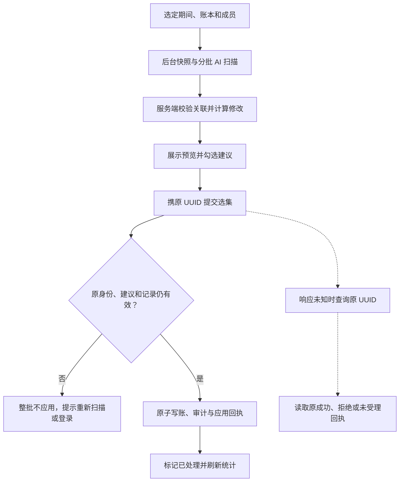

> 由 scope skill 于 2026-11-05 生成
> 状态：已批准 2026-11-05

# AI 对账与一键应用

## 目标

将首页的 AI 账单分析改为 AI 对账：从已入账记录中找出重复记账，以及可以与原支出抵扣的退款、报销收入，展示修改前后的账目，再由用户一键应用勾选的建议。新的结果聚焦账目核对，不再生成消费趋势解读和支出优化建议。

本文是已批准的设计基线，不代表功能已实现或发布。现有行为以 [AI 账单分析](../wiki/ai-bill-analysis.md) 和代码为依据；本文覆盖原分析的产品输出与写账边界，后台执行、身份和资源保护等未改变的规则继续适用。

## 决策基线

### 需求决策

- 入口沿用 `/home` 的月／年视图，改名为“AI 对账”。扫描沿用提交时选择的期间、账本查看范围和归属成员；当前月／年截止今日，统一按 `Asia/Shanghai` 计算，不自动扩大到其他期间。
- 支持收入或支出的重复记录去重，以及支出与消费退款、明确对应原支出的报销收入抵扣。不做同方向金额相加，不抵扣普通收入、转账、借还款，不查询外部账户或核对银行余额。
- 同一可应用建议涉及的记录必须属于同家庭、同账本、同一个 `actorMemberId`。跨账本或跨归属成员的疑似关联仅提示，不可勾选；同名但不同历史成员 ID 不视为同一成员。不得读取用户选定范围之外的交易来补配对。
- 修改前展示原记录、关联理由、保留记录、逐笔修改结果，以及整个选集和受影响日期／月份的收入、支出、结余、笔数变化。高可信且通过服务端校验的建议默认勾选；不确定但符合操作边界的候选默认不选，用户可手动选择。不能仅凭模型自报的高置信度或导入补齐的时间预选。
- 去重只处理同方向且 `amountFen` 相等的重复记录，保留一笔原记录，其余软删除；同事项但金额不同的记录仅提示，不能当作普通重复删除。退款／报销部分抵扣时，保留原支出并减小金额，软删除被抵扣的收入；全额抵扣时相关支出与收入均软删除，不创建零金额交易。保留记录的日期、分类、成员、账本、备注、创建者、UUID 和来源字段不改写。
- 一笔支出可以对应多笔明确关联的退款／报销收入；同一收入只能抵扣一次。合计超过原支出的收入不生成可应用建议，不自动拆分收入或转为净收入。一次收入对应多笔不同支出的分摊本期仅提示。
- 一键应用只处理本次勾选项。本次涉及的任何记录发生变化、删除、移动，或账本不再可写时，整批不应用，提示受影响项并要求重新扫描；不跳过冲突项继续写账。
- 已返回的应用业务终态固定绑定原 UUID。明确业务拒绝必须先安全持久化再返回，后续重试或迟到请求不能因条件恢复而转为成功；无法确认持久终态时显示结果待确认，不把请求级访问失败等同于该 UUID 已最终拒绝。
- 家庭有效成员按现有编辑权限查看并应用共享结果，应用不限定原扫描发起者；应用必须由当前用户明确点击触发。后台扫描、锁屏、关闭应用或重开报告都不会自动改账。
- 保留已提交任务的后台生成、原会话取消、真实进度、失败保留旧成功结果和重开后的任务发现。历史分析报告保留只读，不转换为可应用建议。应用后的旧建议显示已处理；重新扫描才产生新的判断。
- 本期不新增一键撤销、批量恢复或操作历史管理页面；软删除原记录和必要回执保留。本人关闭 AI 选择后不再接收新扫描，历史结果查看与不调用模型的应用继续受当前编辑权限约束。

### 技术决策

- 复用现有 Next.js、Prisma／PostgreSQL、独立 `import-agent`、WheelMaker Responses API、Astra 配置和服务端后台运行器，不引入新的供应商、队列、常驻密钥或部署服务。
- 对账使用独立的 `bill-reconciliation.v1` 结构化协议。AI 只提出记录关联与理由；金额计算、保留／删除动作、预选条件和最终写入由服务端确定。旧 `bill-analysis.v1` 文本报告不能进入应用接口。
- 复用 `BillAnalysisReport`、`BillAnalysisRequest`，在受保护定义及内容中增加用途和内容版本，区分旧分析与新对账。同范围两种用途使用不同报告槽，旧数据不回填或重算；新对账仍只保留该槽最新成功结果。
- 新增一个受保护的应用回执模型 `BillReconciliationApplication`，承担批量应用的 UUID 幂等和未知结果核验；与报告、家庭、历史操作者使用同家庭组合外键。不得把敏感操作载荷放入 `LedgerAuditLog`。
- 扫描使用一致快照；推理不持数据库事务。应用使用独立的短事务，沿用家庭、成员／账号／会话、账本的锁序，再取得应用 UUID 锁及报告锁；多个账本按稳定 ID 次序加锁，全部写账与回执原子提交。
- 不扩大原 AI 资源边界：本期最多 10,000 笔／8 MiB，单批最多 500 笔／256 KiB，最多 24 批；单批模型调用最多 90 秒，任务执行含取数和窗口等待最多 8 分钟，租约 9 分钟且不续租。超时后停止实际工作，清理未确认完成时仍保留安全占用及原回收责任。新协议直接汇集结构化建议，不再调用旧消费分析的总结阶段。
- 所有涉及金额的计算使用整数分，结果须满足数据库整数范围和正金额约束；结余按收入减支出重算。新增接口、提示和状态同步中文、英文。

## 设计视图

### 功能设计

用户在月／年视图打开 AI 对账，看到本次期间、账本、成员和数据发送说明后发起扫描。生成后的结果分为可应用建议、待确认候选、仅提示项；无发现时说明“本次未发现可处理项”，不宣称账目已被证明完全正确。归档账本的记录可以参与查看和识别，相关建议保持只读；恢复账本后也须重新扫描才能应用。

每项建议用一组原记录与修改结果表达，显示实际日期时间、方向、金额、分类、备注、来源及可识别的成员／账本标签。去重项明确哪笔保留；抵扣项明确收入属于退款还是报销，以及支出如何变为净额。备注和 AI 理由按纯文本显示，不执行 HTML 或模型链接。

服务端为信息更完整的原记录选择稳定的默认保留项，不拼接或改写其字段。若去重与抵扣属于同一明确事项，例如重复的两笔 100 元支出及一笔 30 元退款，合成一项建议，先保留唯一支出，再抵扣为 70 元；不能把同一笔退款算两次。无法消除的多种关联作为互斥候选，默认均不选；选中一项时取消与其重叠的其他项，服务端仍独立拒绝重叠提交。

勾选后，面板按整个选集重算修改预览。单纯的退款／报销抵扣会同时减少有效收入和有效支出，只有包含全部关联记录的完整选集结余保持不变；去重可能改变收入、支出和结余。由于保留支出原日期并删除收入，跨日或跨月抵扣会改变各日期／月份的统计分布。预览按上海日期展示本次选集造成的收入、支出、结余、笔数增减，年视图另汇总到月份，并明确提示历史趋势及比较结果会随之变化；不额外读取期外账目。

例如 1 月支出 100 元、2 月报销收入 30 元，在年度对账中抵扣后变为 1 月支出 70 元、2 月收入删除。全年结余仍为 −70 元，但 1 月结余增加 30 元、2 月结余减少 30 元。预览须同时表达总体与分期变化，不只显示“减少若干笔”。没有勾选项时禁用应用按钮。

“一键应用所选修改”直接提交当前完整预览，不再逐项弹窗。提交期间锁定选集和按钮；已确认的拒绝终态保证本次未改账，界面保持选集并展示受控原因。明确冲突时禁用本次失效选集，提供重新扫描入口；授权失效时转入现有登录／身份处理，但保留原 UUID 的待核验状态，不能据请求级错误宣称原操作已最终拒绝。成功后标记已处理建议，刷新首页统计、记录列表和对账结果。其他成员已应用的建议在刷新后同样显示已处理。

提交响应丢失时显示“结果待确认”，只查询原 UUID，不换 UUID、不自动重发修改。切换页面或账本不改变已提交选集；重开后只能发现／查询原结果，不恢复自动提交。对账现场只保留身份绑定的非财务核验信息，不持久化原记录、备注或建议正文，不新增家庭码副本；家庭码继续由现有受保护 IndexedDB／Keystore 管理。

### 技术设计

#### 整体方案

扫描沿用短提交、后台执行、正文状态查询和家庭共享报告；新增的应用链路与扫描执行分离。后台运行器没有写交易的权限路径，应用接口不调用模型或消耗新 AI 额度。

图中的未知结果查询只核验数据库终态，不重新进入写账流程。扫描失败、超限或取消不发布部分建议；一次应用也没有部分成功状态。

#### 输入、候选与识别规则

1. **固定快照。** 在同一 `RepeatableRead` 快照内校验查看范围，读取有效交易及必要的已完成导入抵扣信息、既往对账应用事实。选取原样 `occurredAt`、`updatedAt`、成员／账本／分类引用、方向、金额、备注及来源字段；另由可核验的来源契约或现存来源元数据派生时间精度和是否补齐、聚合的证据标签，不把数据库时间字段本身当作精度证明。无法确认原记录精度、来源契约是否适用或后续修改影响时标记为未知，不猜测回填。依赖查询限定同家庭并按数量／字节有界；加密模式继续先约束密文扫描，再逐页解密。
2. **最小模型输入。** 每笔记录使用任务内引用、上海日期时间及其精度／补齐／聚合标签、方向、整数分金额、分类、原文备注、来源类型及成员／账本代号。来源指纹只在服务端比较，可向模型提供“同来源标识一致”“已有抵扣”等必要关系标签；不发送原始指纹、银行余额、数据库 ID、导入原始行、账号邮箱或家庭码。数据说明明确时间、备注和来源会参与对账，不声称全面匿名化。
3. **完整遍历与跨批候选。** 所选交易全部进入候选准备和至少一个上下文扫描批次。服务端在整份快照上按时间、金额、方向、备注中的事项线索、来源一致性建立候选；再为跨批疑似重复或抵扣关系建立完整候选组审查批次。不能沿用“每 500 笔切开、最后只看文字摘要”的旧策略。上下文批次和候选审查批次共同计入 24 批及输入预算，同一候选组不可被拆成互不知情的请求。
4. **预检及覆盖说明。** 正式调用前固定全部批次计划，校验重复发送后的累计输入字节、批数和组大小；任一候选组超过单批边界或整份计划超限，整个任务返回 `TOO_LARGE`，不截取前若干项冒充完整扫描。所有批次都成功后才发布结果。完整扫描表示记录和计划内候选均被处理，不代表 AI 能发现所有真实业务关联。
5. **受限结构化结果。** 模型只返回请求中确实共同出现的交易引用、重复组／抵扣关系、退款或报销类型、理由、必要备注证据及置信等级。不接受任意交易 ID、SQL、金额覆盖值、移动账本或修改成员的指令。单批结果最多 4 KiB，合并后的公开结果最多 64 KiB；超限明确失败，不让模型自行省略后仍显示完成。
6. **服务端复核。** 校验引用确实属于本次快照、组内记录方向与金额关系合法、所有权一致、收入未重复消费、退款／报销未在导入或此前对账中抵扣。不能仅因日期和金额相同判定重复，也不能只凭“退款”“报销”字样把收入与唯一支出强行配对。缺少事项依据、原支出不在范围内、分摊不明确或抵扣历史无法核实的项目只提示。
7. **高可信门槛。** 模型高置信度之外，重复项须具备共享的同一笔支付／入账标识，或可核验的非补齐交易时间、金额及有区分度的非空事项说明一致且没有相反证据。时间匹配必须按已核实的原输入粒度比较，不能从统一存储格式推定精度；日级、补齐、聚合或精度未知的记录不能走时间匹配预选路径，但仍可凭独立的同笔支付／入账标识判断。同来源的不同稳定流水标识须作为反证，不能仅凭相同展示字段预选。普通摘要、商户名、事项编号或分期总订单号不能单独作为同一笔交易的证明。抵扣项须具备明确退款／报销语义、可引用的共同事项线索、唯一可用原支出，收入时间不早于支出；日级或未知精度不能证明所需的先后关系时不默认勾选。所有结构与金额检查通过、无关联歧义、无重叠候选且账本可写后才能默认勾选。只有结构合法但关联需人工判断的候选可手选；跨归属、不同金额去重、超额抵扣等硬性不合法项不能通过手选绕过。

招商银行现有导入只保留日级日期，`00:00` 是补齐值；同日同额同备注的不同流水不能由时间匹配路径默认勾选。微信、支付宝、随手记虽解析时分秒，也须核实来源契约适用于当前记录，不能仅因来源名称或存储值带时分秒就认定精度。来源原字段不完整、经聚合或人工修改后无法证明精度的记录按未知处理。服务端只使用必要的精度和一致性判断，不为此新增银行余额采集、日志或模型输入。

退款和报销可混合对应一笔支出，但抵扣总额只计算去重后的收入。已完成导入记录如已将原支出减为净额，不能再次使用被覆盖的退款收入；对无法证明尚未抵扣的旧数据不猜测。依赖扫描超过预算时失败，不降级为忽略导入历史。

各来源的现存抵扣证据不同：招商银行保存原金额及退款指纹，微信部分退款保存原金额但部分退款收入会按对手聚合为剩余金额，支付宝解析后按净额入账却未在草稿中保留同等完整的原金额及退款关联。实施须分别验证可证明未抵扣、已抵扣和证据不足的情况；证据不足时仅提示，不从“未查到关联”推定为尚未抵扣，不承诺各来源有相同的自动应用覆盖率。

#### 建议、快照与应用回执

| 对象 | 设计与职责 |
| --- | --- |
| 报告定义 | 在受保护载荷中记录 `purpose: reconciliation`、内容版本及原范围；缺少用途的旧载荷按旧分析解析。报告槽按用途和规范化范围识别，不建立可推测财务范围的明文 hash。 |
| 对账建议 | 服务端生成稳定建议 ID；保存涉及引用、保留／软删除动作、可选抵扣关系、理由、证据、可信等级、预选结果及只读原因。所有实际修改均可由原快照确定性重算。 |
| 内部快照断言 | 只保存建议涉及记录及必要依赖的真实 ID、原 `updatedAt`、完整业务字段和关系检查依据，包含时间精度／来源一致性证据及抵扣历史断言。断言用于拒绝过期建议，不作为客户端提交的可信数据。未被引用的全量输入和中间结果在任务结束后清空。 |
| 公共 DTO | 返回获准范围、原记录展示、整体及分日／分月修改预览、建议状态和应用能力；不返回内部指纹、完整版本断言、来源原始行、原会话、owner、租约或密钥。 |
| `BillReconciliationApplication` | 明文仅保存必要路由元数据、UUID、终态、时间及组合外键；受保护载荷保存原选集摘要、报告代次、涉及建议与处理结果。唯一键为家庭、操作者成员、`clientRequestId`，不加入账本。终态至少区分成功、明确拒绝和查询关闭的未受理。 |

对账结果初始上限为 200 项建议、合计 1,000 笔不同交易；仅提示项也受正文总量限制。超出任一结果边界时任务明确失败并建议缩小扫描范围，不静默隐藏发现项。该上限同时限制一次应用的解密、版本校验、写账和审计规模，超大选集在写入前拒绝。

报告以成功 `generation` 标识建议版本。新扫描准备期间不允许应用同槽的旧建议，以免界面与新结果交错；扫描失败后可再次打开旧结果，但应用仍须核验其原记录。新扫描成功替换正文后，旧代次不再允许新应用。已成功的原应用 UUID 仍返回其原回执，不因新代次或账本后来归档而改写。

#### 应用接口与原子流程

新增同源正文 `POST /api/reports/reconcile`，承接对账的生成、状态／列表读取、取消、报告读取，以及 `apply`、`query-application`。所有操作要求当前有效 `AppSession`，响应采用 `no-store`、`no-referrer`；财务内容和解锁材料不放入 URL 或初始加密 SSR。旧分析接口继续允许获准的历史读取和原任务收敛，拒绝新的旧协议生成。

`apply` 只接受原 UUID、报告 ID、成功代次和建议 ID 选集，另携现有家庭解锁材料。目标记录、成员、账本、金额和操作内容均从服务器报告派生，不能让客户端直接提交 SQL 式补丁。选集排序去重后，与报告代次、用途及内容版本计算稳定请求摘要。

应用顺序如下：

1. 校验输入大小、同源、当前身份和家庭加密上下文。在短事务中先锁家庭、当前成员／账号／会话，再按稳定次序锁涉及账本，随后按同一顺序锁应用 UUID 和报告。查询关闭标记也使用相同的家庭优先顺序。
2. 已存在同 UUID 回执时，摘要一致则返回原终态，包含原成功或原明确拒绝；摘要不同则拒绝本次请求但不覆盖原终态。无原选集摘要的查询关闭标记直接返回 `NOT_ACCEPTED`，不能被后到的 `apply` 补写摘要或变成成功。所有原终态查询均不再次写交易、报告或审计。
3. 核验报告属于当前家庭、用途和代次正确、没有替换中的扫描；批量读取选集及涉及记录。逐笔比较快照断言、软删除状态、原账本／成员、来源和抵扣依赖，复核账本可写、家庭／身份／会话仍有效及加密模式代次。历史成员本身不妨碍编辑保留其归属的历史记录。
4. 完整请求已绑定 UUID 及选集摘要后，任一业务检查失败均整批零改账；身份及模式允许安全写回执时，必须在同一 UUID 锁内原子保存拒绝终态、原摘要及受控原因，确认事务提交后才返回明确业务拒绝。以后条件恢复、重扫失败或旧报告恢复可用，也只返回该 UUID 的原拒绝；用户如要再次应用，须重新确认有效预览并明确发起新 UUID，不由系统自动重发。拒绝回执写入失败或提交结果未知时只返回未知，不能宣称已最终拒绝。输入／同源／身份／模式校验不允许建立安全回执的错误属于本次请求的访问失败，不构成该 UUID 的持久业务终态；不得为了记录错误而越权写库，客户端继续保留原 UUID，待当前合法身份可核验时查询，不重放旧请求。
5. 重算去重后的净额与整组选集预览，拒绝重复消费、重叠动作、金额溢出或与预览不符。批量读取、分组／分块更新，使用显式 Prisma transaction timeout，避免逐笔查询或为每项建议另开事务。块是同一个事务内的写入单位，不是独立提交单位；任一失败回滚全部。
6. 更新有效支出的金额并软删除应移除记录，保留全部原 ID、来源和 UUID；同事务批量写最小 `LedgerAuditLog` 与成功回执。审计沿用 `TRANSACTION_UPDATED`、`TRANSACTION_DELETED`，只记真实发生的修改，不复制金额、备注或 AI 原文。成功后报告读取通过同代次应用事实派生已处理状态。
7. 事务提交后返回成功及原预览对应的计数，触发客户端刷新。成功或拒绝回执的数据库提交结果未知时只返回未知并查询原 UUID，不能返回失败诱导新 UUID 重试。两名成员以不同 UUID 应用同一建议时，家庭／报告锁与原记录断言确保至多一次生效。

`query-application` 仅向原合法操作者身份返回其 UUID 回执；同身份重新登录可核验成功或拒绝终态，失效的旧请求不能因此获得执行授权。查询遇到在途同 UUID 写入时按相同锁等待或返回未知；取得锁后先返回已有终态及原受控原因，不用 `NOT_ACCEPTED` 替换原拒绝。确认仍无回执且允许安全写入时，先保存并确认提交 `NOT_ACCEPTED` 关闭标记，再返回未受理，阻止稍后到达的原提交；否则继续返回未知或请求级访问失败。暂时数据库失败不等于未受理；只读报告发现不代其他成员写关闭标记。同家庭其他成员可以看到建议已处理，但不取得他人的 UUID、会话或执行凭据。

客户端只持久化身份绑定的 UUID、协议版本和查询所需的非财务路由信息；没有原选集也可核验结果，不能从持久化状态自动重放写入。已受理扫描关闭 AI 选择后的完成规则沿用现有实现；应用不创建新的供应商任务。

#### 来源、加密与历史兼容

- 对账改账不重写手工／导入／自然语言请求的原摘要与完成结果，也不把保留记录重新创建为当前操作者的交易。同源导入去重继续包含软删除记录；确认导入时重核对账后来源占用，不能因净额变化把原流水重新导入。必要适配限定在既有来源去重与抵扣历史查询，不改导入入口、分类或来源解析规则。
- `BillReconciliationApplication` 及报告新增载荷进入 `protectedModels`、SQL 护栏、转换、换钥和恢复校验。不得把金额、来源指纹、选集或财务摘要旁路存为明文列／索引。单次应用使用自己的请求 key ring，不复用已结束的后台任务材料。
- 新财务恢复格式升级为 v3，覆盖新应用回执及相应删除检查点。v1／v2 按各自原固定实体集合验证原 proof／digest 后，才补空新增模型；v3 缺新实体集合须拒绝。恢复保留成功回执与记录状态，不恢复 `AppSession`、在途执行或自动应用能力。
- 报告旧载荷、新载荷按用途和版本严格分流；未知版本拒绝，不把旧文本“建议”解析成交易动作。原 `BillAnalysisRequest` UUID、原成功结果和后台所有者不回填重写。上版已受理任务按原生命周期结束或按既有停止证明收敛，禁止部署时续跑旧输入。
- 维持独立 Agent 的 `ephemeral: true`、`store: false`、禁用工具、不自动重试或模型回退，以及共享全局／家庭／成员额度。取消和超时须等待本地 HTTP 工作及清理结束后释放占用，不增加逐请求 Hub 停止确认。

### 预估改动面

- `src/app/(app)/home/view.tsx`、`src/components/bill-analysis-*.tsx`、客户端报告控制器及 `src/lib/i18n.ts`：对账入口、建议分组、勾选／互斥、确定性预览、应用状态和旧报告只读展示；不顺手重做首页布局。
- `src/app/api/reports/`、`src/lib/reports/`：新协议、完整快照与候选准备、批次计划、报告用途分流、应用服务及 UUID 查询。沿用现有运行器／owner／租约清理，不进行无关文件重命名。
- `agent/`：新增受认证的内部 `/reconcile-bill` 能力、结构化提示与结果验证；沿用 Astra 配置及传输预算，不向 Agent 开放数据库或写账工具。
- `prisma/schema.prisma`、增量迁移、`src/lib/encryption/`：应用回执模型、同家庭约束与必要索引，受保护载荷和 v1／v2／v3 恢复兼容。现有生产库不 seed。
- `src/lib/imports/`、交易审计辅助及相关测试：仅补齐对账后的去重／抵扣来源核验和批量写入能力；保留原来源字段、原 UUID 与已完成结果。
- `tests/unit/`、`tests/integration/`、`tests/e2e/`：识别与协议、快照、真实数据库应用／竞态、后台／加密／恢复、移动中英文流程。
- wiki 目标：更新 `docs/wiki/ai-bill-analysis.md`、`docs/wiki/wiki.md`、`docs/wiki/household-encryption.md`；同步 `README.md` 及受影响的 AI、导入说明与 runbook。原 scope 文档保留为历史基线，不回写成已实现新行为。
- Git 收尾：沿用本 spec 的任务分支与 worktree；按 Git 偏好，spec 批准后不单独提交，随实现形成一个目标一致的 feature 提交。实施完成时按当时基线递增 `Y` 并置 `Z` 为 `0`，完整验证、安全审查、合回 `master`、推送核验后执行适用发布。

## 验收

- 月／年入口及所选期间、账本、成员 → 新任务使用固定原范围，切换筛选不改变在途输入；归档账本、历史成员可读，软删除排除；单元、快照集成与浏览器验证。
- 真重复、同日同额的不同消费、同事项不同金额或分期／拆单、成员／账本不同的相似记录 → 可执行去重严格要求同方向、同金额及事项依据，跨归属或不同金额只提示，真实多笔消费不默认预选；合成账目夹具、提示／协议和服务集成验证。
- 招商银行同日同额同备注但余额不同的真实流水、日级补零记录与另一来源同额同备注的记录，以及精度未知或聚合记录 → 不能由相同存储时间触发默认预选，服务端识别精度／来源反证；另以可核验同笔流水标识的真重复验证独立标识路径；来源解析夹具及协议／服务集成验证，不向模型或日志发送余额及指纹。
- 支出 100 元与退款或报销 30 元 → 预览及实际结果均为原日期／分类／归属的支出 70 元，收入软删除，包含全部关联记录的完整选集结余不变；金额纯函数、真实数据库与端到端验证。
- 1 月支出 100 元、2 月退款或报销收入 30 元，以及同月跨日的等价场景 → 总体结余不变，原支出所在月／日的结余增加 30 元，收入所在月／日的结余减少 30 元，收入／支出／笔数分布与预览一致，按 `Asia/Shanghai` 日期及月份重查的统计和趋势一致；纯函数、真实报表查询及中英文端到端验证。
- 支出 100 元与关联收入 100 元，或多笔退款／报销合计 100 元 → 全额软删除、不创建零金额；支出 100 元与收入 120 元、普通收入、转账／借还款及分摊不明 → 不提供可应用抵扣；边界与集成验证。
- 两笔重复支出及退款、重复退款收入、已在导入或旧对账中抵扣的退款 → 单组只计算一次，结果与确定性预览一致；无法核实的旧来源仅提示，不能双重抵扣；组合建议及导入兼容集成验证。
- 招商银行、微信、支付宝各自的完整、已消费、聚合或缺失抵扣证据 → 仅在可证明未抵扣时生成可应用抵扣，已消费与证据不足分别显示受控原因，不把查询未命中当作未抵扣证明；按来源覆盖历史净额夹具及真实数据库集成验证。
- 关联记录跨 500 笔或字节批界、候选时间跨度跨月但仍在所选年内 → 完整候选组进入共同审查，引用全部有据；期外原支出不被读取；批次计划、Agent 请求观察及集成验证。
- 输入／候选／调用计划、单批结果或最终建议超过边界，任一批失败／取消 → 明确失败，不发布部分建议，不悄悄缩短覆盖范围，旧成功结果保留；资源、协议、服务与故障注入验证。
- 稀疏与密集跨批候选、长备注及接近 10,000 笔的代表性合成账目 → 实施验证记录原记录数、累计输入字节、上下文／补扫批数、调用数、用时和是否完整完成；明确区分硬上限与已实测可完成规模。10,000 笔在单批满额时已占 20 批，跨批补扫仍须在余下最多 4 批及原总预算内完成，超过则按原规则拒绝，不通过提额、截断或省略候选取得完成结果；批次计划测试与隔离 Agent 夹具运行验证，记录不含财务正文或真实入口。
- 高可信建议、待确认候选、只读提示和重叠候选 → 预选由服务端门槛决定，用户可取消，非法项不可选，互斥选择及空选集行为正确；组件和移动端到端验证。伪造选择不能绕过服务端限制。
- 手动编辑、删除、移动任一选中记录，或归档选中账本、替换报告代次 → 本次整批零改账，不产生部分审计，显示受影响项及重新扫描入口；真实 PostgreSQL 并发／回滚验证。
- 同 UUID 连点／重试、同 UUID 不同选集、两名成员并发应用、响应丢失、迟到原请求与 `NOT_ACCEPTED` 竞态 → 至多一次生效，摘要冲突拒绝，原终态可核验，未知不触发新写入；接口／数据库并发及浏览器验证。
- `apply(U)` 在重扫中被明确拒绝，重扫随后失败且旧建议恢复可用，原 UUID 的重复请求再迟到 → 仍返回已持久化的原拒绝原因，不改账、不写交易审计，查询不把原拒绝改成 `NOT_ACCEPTED`；真实 PostgreSQL 竞态验证。
- 成功、拒绝或查询关闭回执写入失败／提交结果未知，以及身份或模式不允许安全写回执 → 不把未确认写入宣称为成功、最终拒绝或未受理，客户端保留原 UUID 并按当前权限核验；数据库故障注入、授权／模式竞态及浏览器状态验证。
- 应用时退出登录、OPS 撤销、成员离开／重新加入、家庭关闭或加密模式变化 → 在统一锁序内拒绝不再合法的提交；其他家庭 ID、伪造记录／账本／成员／金额同样无效；授权与模式竞态集成验证。
- 应用后统计、明细、同家庭其他成员的报告状态，以及后续同源导入 → 金额和笔数与预览一致，已处理项不可再次使用，软删除仍参与来源去重；原自然语言／导入完成结果和 UUID 不变；查询、导入回归与端到端验证。
- 历史分析、新对账、同范围重新扫描及本人关闭 AI 选择 → 旧报告只读且不被新槽覆盖，新扫描需要 AI 同意，获准历史应用不调用模型；旧新协议、共享权限和浏览器验证。
- 后台生成后关闭全部客户端、显式取消、原会话撤销和服务重启 → 继续遵守上一版后台执行与停止证明规则，扫描从不自行改账；隔离虚构家庭、真实自托管进程与受控 Agent 延迟验证。
- 未加密及加密家庭的扫描／应用、转换／换钥与 v1／v2／v3 隔离恢复 → 财务载荷不旁路泄露，缺失新版实体拒绝，成功回执和软删除一致，不重建会话或可执行任务；加密、恢复集成及日志／文件检查。
- 中文和英文移动界面、键盘操作及未知结果恢复 → 范围、记录、理由、预览、冲突和结果一致可理解，标签可读、焦点可达，重开不重放写入；组件及移动视口端到端验证。
- 实施交付 → `npm run lint`、`npm run test:unit`、`npm run test:integration`、`npm run test:e2e`，必要 Prisma／恢复与真实运行检查，以及 BillBoard 安全审查均通过后，完成适用 Git／发布和健康检查。本 spec 的文档检查不作为实现或上线证据。
