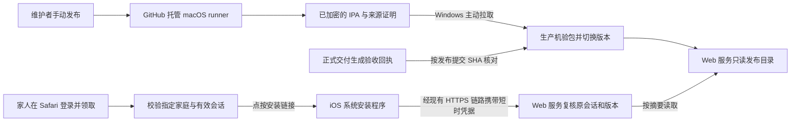

> 由 scope skill 于 2026-11-18 生成
> 状态：已批准 2026-11-18
> 读者：实施 Agent 与审阅者

# 使用 GitHub Actions 构建和发布 BillBoard 家庭 iOS 客户端

## 目标

维护者在 GitHub Actions 点一次「发布 iOS」，家人即可在已登记的 iPhone 上用 Safari 登录 BillBoard，从 `/help` 安装或更新客户端。在 App 内可以使用同一套家庭账本，完成手工记账、查询、语音、账单导入和 Excel 导出。

## 决策基线

### 需求决策

- 首版面向家庭自用，采用 Apple Ad Hoc 分发。Safari 中只有指定家庭的有效成员可以发起领取。iPhone 的设备登记用于 Apple 安装资格，App 内的账务访问由本人账号和服务端 `AppSession` 授权。
- 安装及覆盖更新共用 `/help` 的 iOS 入口。帮助页面向所有人提供教程、注册申请以及 Android 和 Windows 下载。首版使用系统安装界面，更新由家人在 Safari 主动发起。
- 在本仓库新增联网 `WKWebView` 客户端，复用移动网页及中英文。真机覆盖登录保持、手工记账和查询、录一笔语音账、从「文件」选择账单导入、将导出的 `.xlsx` 保存到「文件」。
- 已有 Apple Developer Program 会员，首发准备包含设置稳定的 Bundle ID 和匹配的 App ID、登记 iPhone、准备含私钥的 Apple Distribution 证书（`.p12` 及其密码）和 Ad Hoc 描述文件。机型和 iOS 版本在登记时记录。网页框架的 Safari 16.4 基线用于设计参考，兼容结论按登记设备的实测结果发布。[Apple Ad Hoc 签名要求](https://developer.apple.com/help/account/provisioning-profiles/create-an-ad-hoc-provisioning-profile/)

### 技术决策

- 只通过正式仓库的 `workflow_dispatch` 从已按仓库规则验收并推送的 `master` 提交发包。GitHub 托管的 macOS runner 使用 Xcode 构建、测试、签名并导出 IPA。网页部署、PR 和普通推送均不触发 iOS 发版。
- 公开仓库只暂存用 Windows 生产机公钥加密的产物。生产机通过出站连接自动取包，来源与内容校验通过后发布。Apple 签名材料和真实 HTTPS 服务入口放在限 `master` 的 GitHub 发布环境，解密私钥仅由生产机保管。Ad Hoc 描述文件内含设备标识，明文 IPA 和描述文件仅进入受控签名、发布及授权领取环节。[Apple 描述文件说明](https://developer.apple.com/documentation/technotes/tn3125-inside-code-signing-provisioning-profiles)
- App 使用构建时注入的固定 HTTPS 根 origin 和持久化的独立 WebKit 数据存储。家庭授权、账本归属、本人 AI／语音选择、加密及导入导出规则继续使用服务端现有实现。

## 设计视图

### 功能设计

家人在 Safari 打开 `/help` 的 iOS 安装区。未登录时可点「登录以安装」，登录成功后自动返回该安装区。符合领取条件且有有效发布时，页面显示 iOS 版本和构建号。家人领取后点按生成的「安装 iOS 版」，由系统提示安装。安装凭据过期时可以在原入口重新领取。

覆盖更新沿用同一 Bundle ID 和团队标识，保留已持久化的 App 登录资料。再次打开由服务端判断会话和家庭身份是否仍有效。App 首次使用在自己的窗口登录，Safari 的安装授权仅供系统取包。

客户端只在可信主页面按需请求麦克风。语音记账复用现有 `getUserMedia`、`AudioWorklet` 和账户同意检查，权限拒绝或录音中断时可以继续手工记账。导入使用系统文件选择器和现有 `/records/import` 草稿流程。Excel 沿用 `POST /api/records/export` 的日期、家庭及账本授权，将该次成功响应的文件交给系统保存界面。取消选取或保存可回到原页面，只有实际保存完成才提示成功。网页和原生权限、取消、错误提示均提供中英文。

### 技术设计

#### 正式验证证据

正式交付按 `AGENTS.md` 第 6 节记录实际受验源码的 Git tree，将对应报告按受验内容和范围归档。补跑、修复或 rebase 改变待交付内容时，在合入和推送前按第 6 节核对证据有效范围，补验受影响的部分。汇总须保留原始失败与补跑的对应关系，并证明最终受验内容的 lint、unit、integration 和 E2E 全量覆盖均通过。

核对实际推送至 `origin/master` 的 SHA 与受验 Git tree 后，正式交付流程将脱敏汇总与引用报告保存到 Windows 生产工作目录中受限的 `tmp/verification/releases/`，最后原子写入以最终提交 SHA 命名的验收回执。回执包含正式仓库、分支、提交 SHA、Git tree、四套件的覆盖及结果、报告引用和补跑对应关系。任务工作树清理后可独立读取。回执由本机正式交付流程写入。同一受验提交重复签名时可复用仍有效的回执。

#### 构建与发布

1. 首次配置时在生产机生成加密密钥对，将接收方公钥装入受限发布环境。触发时固定正式仓库、工作流、`refs/heads/master` 和提交 SHA。检出该 SHA，固定 macOS 镜像系列、Xcode 版本、Action 提交及加密工具版本与摘要。先运行不含真实签名材料的模拟器测试。签名作业使用临时钥匙串导入 `.p12`，装入匹配的描述文件。新设备在 Apple 后台登记后更新该文件，再点一次发布即可。[GitHub 的 Xcode 签名说明](https://docs.github.com/en/actions/how-tos/deploy/deploy-to-third-party-platforms/sign-xcode-applications)
2. 面向用户的版本取根 `package.json`。构建号按固定工作流运行序号及尝试序号生成，符合 Apple 的数值格式，同一源码重签也可产生更高构建号。runner 对导出后的 App 验证 Apple 代码签名、Team、Bundle ID、Ad Hoc 类型、描述文件与签名证书的匹配和有效期。将结果、有效截止时间、源码 SHA、构建号、IPA 大小和 SHA-256 与 IPA 一起用 `age` 加密给生产机，并为**密文**生成 GitHub 构建来源证明。公开日志、缓存、证明和附件均排除真实入口、设备标识、清单凭据、签名材料及明文构建目录。临时钥匙串与明文文件在作业结束时清理。[age 加密工具](https://github.com/FiloSottile/age) · [GitHub 构建来源证明](https://docs.github.com/en/actions/how-tos/secure-your-work/use-artifact-attestations/use-artifact-attestations)
3. Windows 在现有用户登录运行模式下，每 5 分钟检查一次成功的手动发布，密文暂存 7 天。取包任务只使用读取发布所需的 GitHub 权限。依据 GitHub 运行记录及来源证明，核对正式仓库、指定工作流、托管 runner、分支、提交、运行及尝试、密文摘要。按已核实的提交 SHA 读取本机验收回执，检查仓库、分支、SHA、Git tree 与构建源对应，且四套件全量覆盖均通过。回执缺失、内容不符、验证不全或仍有失败时保留当前版本。回执晚到可在产物保留期内自动补拉。通过后在有大小限制的私有临时目录解密，核对实际 IPA 摘要、大小、包标识、版本、签名验签记录和有效期，处理结束清理临时文件。Mac 负责 Apple 原生验签，Windows 负责验证可信构建来源及收到的包。[GitHub CLI 验证条件](https://cli.github.com/manual/gh_attestation_verify)
4. 生产机串行发布，先将 IPA 写入按摘要命名的不可变文件，再原子切换当前版本清单。重复领取同一构建和摘要视为已处理，同构建号异内容、版本倒退、旧运行晚到或验包失败均保留当前版本。有效领取凭据继续读取绑定的旧摘要直至过期，在途读取完成后再清理旧文件。断网或任务中断在保留期内自动补拉，超期后从已验证的 `master` 重新发包。以生产清单切换且 `/help` 可领取新版作为发布完成。

#### 安装领取和客户端边界

- `/help` 的登录入口发起固定的 iOS 安装意图。登录页将该意图映射到同源固定路径 `/help#ios-install`，登录成功后返回该处。普通登录进入 `/home`。
- 部署私有配置指定可领取的家庭。Safari 用户主动领取时，同源 `POST` 通过 `requireAppSession()` 派生账号、成员和家庭，并固定当前可用 IPA 摘要。未配置家庭、无有效包、签名已过期或身份不匹配时，不能签发安装凭据。公开的 `/api/downloads` 及其平台路由只提供 Android 和 Windows 包。
- 服务端签发加密认证的短时凭据，绑定用途、原会话、成员、家庭、IPA 摘要和绝对到期时间，首版为点击后 10 分钟。Safari 通过 `itms-services` 将同源 HTTPS 安装清单交给系统。清单凭据与 IPA 凭据区分用途，共用原截止时间。系统读取清单及 IPA 时，服务端按原会话重新核验账号、家庭、成员、包的有效期和用途。安装程序无需携带 Safari Cookie。原包允许有效期内的 `HEAD`、`GET`、范围读取与系统重试。凭据是短时持有者凭证，转发期间持有人可能读取原包，安装仍受 Ad Hoc 设备登记限制。[Apple 无线安装清单](https://help.apple.com/xcode/mac/current/en.lproj/devde46df08a.html)
- 地址由可信服务配置生成，凭据及完整安装 URL 排除在帮助页缓存、分析、应用和实际前置转发日志之外。清单及 IPA 使用私有无缓存响应，下载复用有并发上限且可取消的文件流。Web 容器只读挂载正式 iOS 产物目录，OPS 保持本机隔离。
- OTA 复用生产 HTTPS 转发和 frp 链路。按运行手册核对实际 HTTPS 入口 TLS、转发服务到 `frps` 的回源机密性（加密传输或可信网络），以及远端 `3000` 的实际访问来源。使用合成标记核查转发服务和日志采集对清单及 IPA 的正常与失败请求的记录范围。[生产网络检查清单](../runbooks/home-network-checklist.md)
- `WKWebView` 仅信任固定 origin 的主框架来申请原生能力。导入沿用网页文件输入。Excel 保存适配接收本次同源导出成功得到的文件，通过系统文档选择器交付。页面只能发起受限保存动作，不能指定原生路径、任意下载地址或读取 Cookie。导航和重试保留系统 TLS 校验，避免重复提交账务。
- App 在系统不备份的私有临时目录中最多暂存一个 Excel 副本，沿用现有 32 MiB 上限。保存操作自副本创建起有效 10 分钟。完成、取消、失败、退出登录、原身份变化或到期时结束保存，待系统文件选择器释放源文件后清理。App 从挂起回到前台时先检查时限并清理已到期的副本。冷启动先清扫自身导出目录中的遗留副本。清理失败时在再次接受保存任务前重试。[Apple 临时目录说明](https://developer.apple.com/library/archive/documentation/FileManagement/Conceptual/FileSystemProgrammingGuide/FileSystemOverview/FileSystemOverview.html)

### 预估改动面

- 新增 `ios/` 下的 Swift／WebKit Xcode 工程、原生适配与测试，以及 `.github/workflows/` 中的手动发布工作流。构建工具和私有配置示例沿用仓库占位符约定。
- 在 `ops/`、`ops/windows/` 增加正式验收回执交接、加密交付、自动取包和发布逻辑，复用现有安装包发布的文件校验及原子切换方式。`compose.yml` 增加只读产物挂载，检查 `.gitignore`、`.dockerignore` 对私有材料的覆盖。
- 在 `/help`、登录页面、安装专用 route handlers、会话与发布文件读取层以及 `src/lib/i18n.ts` 接入 iOS 领取与登录回跳。按实际需要适配 `src/components/record-export.tsx`。补充授权、发布顺序、文件和真机交互的针对性验证。
- 更新 `README.md` 和对应 Windows／网络运行手册。实施后新建 `docs/wiki/ios-app.md` 并加入 `docs/wiki/wiki.md` 索引，记录设备登记、证书续期、发包、实际安装与更新方法。

## 验收

- **手动构建与签名** → 指定 `master` 上手动发布产生对应 SHA 的有效 Ad Hoc IPA，普通推送、PR、其他分支不能取得签名材料。核对工作流事件、GitHub 发布环境限制、模拟器测试和脱敏验签结果。使用过期或不匹配的测试描述文件应停止发布。
- **私密交付** → 公共作业产物只含密文和可公开的证明信息。用测试密钥走通加解密，核对工作流日志、缓存、附件清单与证明，验证伪造来源、其他工作流、错误密钥或损坏密文均无法发布。
- **正式验证交接** → 在任务工作树完成正式验证并推送后，生产机按最终 SHA 读取匹配 Git tree 的回执及脱敏证据。核对工作树清理后仍可取证，合法全量与补跑汇总可通过。缺失回执、错 SHA 或 Git tree、仅有局部验证或有未解决的失败时保留当前版本。补齐匹配回执后在产物保留期内自动继续。
- **自动上线与恢复** → 一次手动触发后，生产机自动切换到同一构建和摘要。用离线补拉、重复运行、乱序、同构建号异内容及切换前中断验证幂等、旧版可用和在途读取稳定。保留密文过期后重新发包的可操作路径。
- **按家庭领取** → 指定家庭的有效成员可在 Safari 发起安装，匿名、其他家庭、过期或撤销会话、已退出成员均无法领取。集成测试覆盖直接访问、篡改或过期凭据、清单与包换用、领取后撤销以及重加入后的旧会话。无 Safari Cookie 的系统请求仅能在原授权有效时读取指定包，覆盖 `HEAD`、范围重试和版本切换。回归公开帮助页及 Android、Windows 下载。
- **生产 OTA 回源** → 核对实际转发配置与回源保护证据，确认清单及 IPA 经生产 HTTPS 链路交付。在实际入口核对 `HEAD` 和整包 `GET`，验证中断后重试的有效范围请求返回 `206` 和对应字节，以及过期凭据被拒绝。用合成标记验证前置转发及采集日志的正常与失败记录均无安装凭据、完整安装链接或包内容。
- **真机安装与更新** → 在已登记的 iPhone 上从 Safari 未登录开始，打开 `/help`、完成登录并自动回到 `/help#ios-install`，领取和点按系统安装链接，完成首次安装及 App 登录。验证安装链接过期后能在原入口重新领取并安装，再从相同入口覆盖更新到更高构建号。核对已持久化登录资料、服务端会话有效性、设备型号、系统版本和实际系统准备要求。使用受控设备或配置验证 Ad Hoc 登记限制。设备登记前，报告分别标明模拟器证据和待做的真机验收。
- **实际记账** → 用测试账本手工记一笔并查询，在本人开启 AI 和语音后录入一笔，从「文件」导入账单并确认草稿归属，最后保存 `.xlsx` 并打开核对所选范围。用拒绝麦克风、取消选文件和取消保存验证可恢复、无误报和无重复提交。新增中英文提示均可操作。
- **Excel 临时副本** → 验证导出文件大小和并发上限。覆盖取消、保存失败、待保存时退出登录、超时、后台挂起后恢复和保存中强制结束 App。验证恢复或冷启动后该次私有副本被清除，重新导出能正常保存一次。
- **正式交付** → 根据 `AGENTS.md` 完成全量验证、安全审查及适用的部署核验。分别记录已推送提交、GitHub 构建、生产已发布版本和登记设备实测结果，保留可复核且已脱敏的证据。
